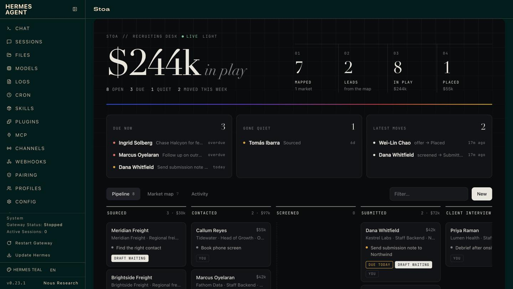
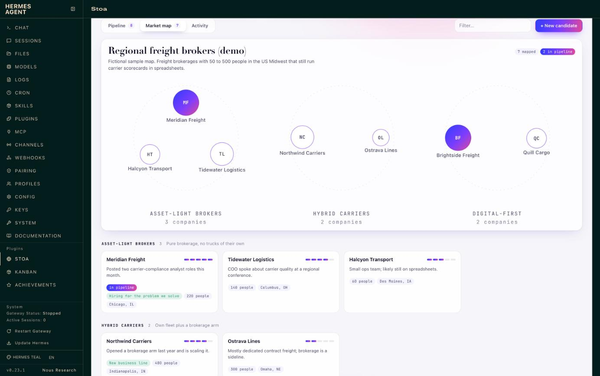
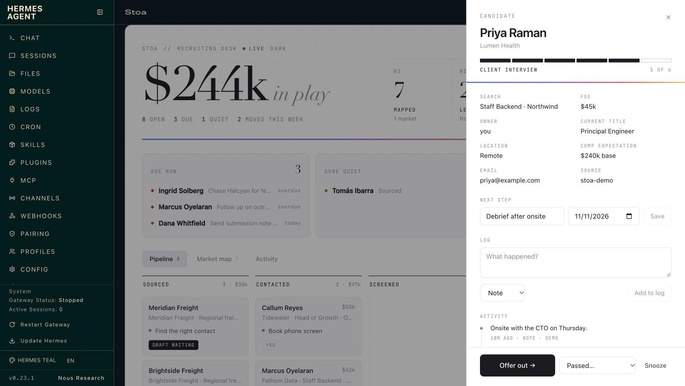
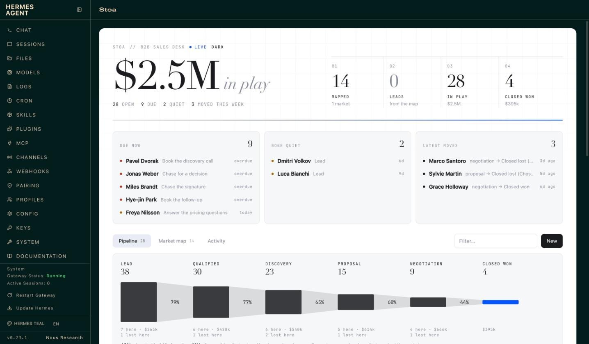

# Stoa

**A go-to-market desk for small teams, inside [Hermes Agent](https://github.com/NousResearch/hermes-agent).**

> *στοά*: the covered walk beside the agora, where the day's business was done.

A two-person sales team does not need a CRM with forty tabs. It needs to know who to sell to,
the pipeline kept honest, the follow-ups written, and the calls turned into next steps, in the
places the team already works: Slack and Gmail. Stoa is that, in one plugin:

**Map the market → find the leads → run the pipeline.**

- **Map any market.** Tell Hermes what you sell. It segments the market, researches companies,
  scores each against your brief with the evidence, and posts the map. One tap on a company puts
  it in the pipeline and sets Hermes to finding the buyer and drafting the first note.
- **Click a button, the stage changes at once.** No model in the loop, no waiting, no wrong stage.
- **Then Hermes does the writing.** The same click hands the follow-up (the outreach note, the
  proposal email, the decline) to the agent, in the card's thread.
- **One file fits it to your business.** A playbook names your stages, your button labels and
  what gets drafted at each step. Recruiting, B2B sales and agency playbooks ship with it, and
  Hermes can interview you and write a new one.

It grew out of a setup a recruiting agency runs its searches on every day. This is that idea,
rebuilt as a plugin anyone can install.

```
hermes plugins install stoa
hermes plugins enable stoa
hermes stoa demo          # optional: fictional records and a sample market map to try it on
```

Then, in any Hermes chat: *"Map the market for us"*, *"What's on my plate?"*, or `/gtm`.

## See it at work

Stoa adds a tab to the Hermes web dashboard. It refreshes every few seconds, so when someone
taps a button in Slack you watch the card move.



- **The number that matters, live:** what is in play, beside mapped → leads → in play → won,
  with what is due and what has gone quiet underneath.
- **Flow:** a Sankey diagram of how far records get: what moves on, what sits in each stage,
  what is lost and where, and what is won.
- **Pipeline board:** a column per playbook stage. Open a card to see its log, set the next
  step, log a call, advance it, close it with a reason, or snooze it.
- **Market map:** every segment as a cluster, each company sized by fit and filled in once it
  is in the pipeline, with the map's reading beneath it: requirement rarity, who holds the
  market, first calls, where segments meet, and a second Sankey from segment to what each
  company uses today. Open a company for its requirements checklist, buyers and source, then
  **Add to pipeline**. **Download page** saves the map as a web page.
- **Activity:** everything that happened, from Slack clicks, the agent and the web alike.
- **Paper and ink.** Neutral in light and dark, with one thin line of colour. A switch picks
  the mode, whatever dashboard theme you run.



Buttons on the web do the same instant, deterministic work as the buttons in Slack. The web
cannot start an agent turn, so when a click calls for a draft the task waits on the record
(the card shows *draft waiting*) and Hermes writes it the next time that record comes up in chat.

| | |
|---|---|
|  |  |

## What it looks like in chat

A card in Slack (shown here as the text version every other surface gets):

```
Dana Whitfield · Kestrel Labs
▰▰▰▱▱▱  Screened · 3 of 6
Search: Staff Backend · Northwind
Fee: $42k
Current title: Senior Backend Engineer
Comp expectation: $210k base
Next: Send submission note to Northwind (due 2026-11-10)

[ Submit to client ]  [ Draft follow-up ]  [ Enrich ]  [ Passed… ▾ ]  [ ⋯ ]
```

Press **Submit to client** and three things happen, in this order:

1. The record moves to *Submitted* and the activity log records who clicked. Instant, in SQLite.
2. The card redraws itself, in every channel it was posted to.
3. Hermes gets a turn in the card's thread with the playbook's instruction for that stage
   (*"Draft the submission note to the client: three bullet points on fit, comp and
   availability, and one honest risk"*) and replies with the draft.

Two people clicking the same button at once move the stage once, not twice.

## What you get

| | |
|---|---|
| **8 tools** | `gtm_market`, `gtm_pipeline`, `gtm_deal`, `gtm_card`, `gtm_enrich`, `gtm_notes`, `gtm_playbook`, `gtm_export` |
| **Market maps** | Segments, fit scores, evidence and sources, with an **Add to pipeline** button per company |
| **Slack cards** | Advance, Draft follow-up, Enrich, close with a reason, snooze, reopen |
| **Web dashboard tab** | Live funnel, pipeline board, market map, activity feed, record side panels with actions |
| **`/gtm`** | The board, the brief, or one record, on every surface Hermes runs on (Slack, Telegram, CLI, Desktop…) |
| **`hermes stoa`** | Status, board, brief, map, sample data, CSV import and export from a terminal |
| **4 automations** | Morning brief, meeting-notes sweep, weekly market watch, Friday review, under `/blueprint` |
| **3 skills** | `stoa:desk` (how the agent runs the desk), `stoa:market-map`, `stoa:playbook-authoring` |
| **3 playbooks** | `b2b-sales`, `recruiting`, `agency`, plus any you or the agent write |

### Market maps

*"We sell carrier-scorecard software to freight brokers in the Midwest. Who should we go after?"*

Hermes names the market, splits it into segments that would each get a different pitch, and
agrees a short list of requirements with you: the things a fit company shows. Then it researches
companies for each segment, with its own web search or with [Exa](https://exa.ai) if you add a
key, and checks every one against those requirements. Each company goes on the map with:

- a fit score from 1 to 5, read off the requirements unless Hermes has reason to set it;
- the evidence for each requirement it shows, and the ones it does not;
- a buying signal, what it uses today, and the likely buyers;
- the source link.

```
Market map · Regional freight brokers
7 companies · 1 in the pipeline

Asset-light brokers (3)
  ●●●●● Meridian Freight · 220 people · Chicago, IL  [in pipeline]
        Posted two carrier-compliance analyst roles this month.
  ●●●●○ Tidewater Logistics · 140 people · Columbus, OH
        COO spoke about carrier quality at a regional conference.

Digital-first (2)
  ●●●●● Brightside Freight · 90 people · Minneapolis, MN
        Raised a Series A and named carrier vetting as a priority.
```

The map then reads itself back. This is the part a list of names never gives you:

| | |
|---|---|
| **How rare each requirement is** | The share of checked companies that show each one. A scarce requirement is either too strict or the first question on every call. |
| **Who holds this market today** | What the companies use now. If most run on spreadsheets, you are selling against the spreadsheet, not a competitor. |
| **Where the segments meet** | Companies that could sit in two segments: the second pool when one runs thin. |
| **Where they are, how big they are** | By region and headcount band. |
| **First calls** | The few to approach first and why, chosen by Hermes or, failing that, the strongest fits spread across segments. |
| **Reading the map** | Hermes's short interpretation and what to do about it, saved with the map. |

In Slack each company has an **Add to pipeline** button. A tap creates the record at the first
stage of your playbook with the first known buyer as the contact, carries the evidence into its
activity log, and asks Hermes to confirm the buyer (or find one) and draft a first-touch note.
The *Market watch* automation re-checks a map every week and adds at most five new companies.

**A page to send.** `gtm_market(action="export")`, or **Download page** in the web tab, writes the
whole map as one self-contained web page: no scripts, no outside requests, nothing to host. The
share version leaves out buyers' names and what is in your pipeline.

### The pipeline

Everything lives in one SQLite file under `<hermes home>/plugin-data/stoa/desk.db`: records,
their activity log, which cards were posted where, and the enrichment cache. It is per profile,
it survives plugin updates, and you can open it with any SQLite tool.

Talk to it in plain language. *"Add Dana from Kestrel to the Northwind search." "I spoke to
Marcus, he wants 210 base, follow up Thursday." "We lost Lumen on price."* The agent writes each
of those to the desk in the same turn; the bundled skill teaches it to treat the desk, not its
memory, as the source of truth.

### Playbooks

A playbook is a short YAML file:

```yaml
name: recruiting
terms: {deal: candidate, deals: candidates, group: search, groups: searches, value: Fee}
stages:
  - {id: screened, label: Screened, stale_days: 3, advance: Submit to client}
  - {id: submitted, label: Submitted, stale_days: 4, advance: Client interview}
won:  {id: placed, label: Placed}
lost: {id: passed, label: Passed, reasons: [Not a fit, Comp mismatch, Client passed]}
drafts:
  on_enter:
    submitted: >
      Draft the submission note to the client for {name}: three bullet points on fit, comp and
      availability, and one honest risk. Quote only what is in the notes.
```

`stale_days` decides when a record counts as gone quiet at that stage. `advance` is the label on
the button. `drafts.on_enter` is what Hermes writes when a record arrives at a stage.

To make your own, tell Hermes how you sell: *"We install commercial solar. Set the desk up for
us."* It asks a few questions, shows you the stages, and saves the playbook. Or copy one from
[`playbooks/`](playbooks/) into `<hermes home>/plugin-data/stoa/playbooks/` and edit it.

### Meeting notes

Point `notes_dir` at any folder of Markdown or text call notes (an Obsidian folder, the export
folder of an open-source meeting recorder, files you drop in by hand), or add a Granola API key.
`gtm_notes` lists the notes that have not been filed and which record each one is probably
about. The agent reads a note, files a short summary on the right record with the next step,
and recommends a stage change for you to confirm. The *File meeting notes* automation does this
a few times a day.

### Enrichment

With a [People Data Labs](https://www.peopledatalabs.com/) key, the **Enrich** button and
`gtm_enrich` look up a person or company and fill the record's blank fields. It never overwrites
what a person typed, results are cached for 90 days, and a monthly cap (default 50 lookups)
keeps the bill predictable.

### Gmail

Stoa writes drafts and never sends. When the Google Workspace skill (or any Gmail tool) is
connected to Hermes, the agent saves what it drafts as a Gmail draft addressed to the record's
email, ready for you to read and send. Without it, drafts arrive in the chat.

### Spreadsheets

`gtm_export` writes the whole pipeline to a CSV that opens in Google Sheets or Excel, and reads
one back in (with a dry run first). That is how you move in from a spreadsheet, and how you get
a copy out for a board meeting.

## Settings

All optional. Set them in the Desktop app under **Settings → Plugins → Stoa**, or in
`config.yaml` under `plugins.entries.stoa.settings`.

| Setting | Default | What it does |
|---|---|---|
| `playbook` | `b2b-sales` | Which playbook the desk runs on |
| `channels` | empty | Chat ids where the desk is available; empty means everywhere |
| `notes_dir` | empty | Folder of call notes to watch |
| `notes_days` | `7` | How far back the notes inbox looks |
| `pdl_monthly_cap` | `50` | Most paid lookups per calendar month (0 = no cap) |
| `PDL_API_KEY` (secret) | empty | Turns on enrichment and buyer lookup |
| `EXA_API_KEY` (secret) | empty | Lets the market map search for companies directly |
| `GRANOLA_API_KEY` (secret) | empty | Adds Granola notes to the inbox |

One permission is worth granting. For a button click to start the agent's writing turn, Hermes
needs to let the plugin queue a message:

```yaml
plugins:
  entries:
    stoa:
      allow_gateway_injection: true
```

Without it everything else still works: the stage moves, the card updates, and the card's thread
gets a line saying *"Saved. Reply here and I'll write it up."*

Hermes lets a plugin continue a conversation a person started, never open one. So a card you
asked for in a conversation hands its drafts straight back to that conversation. A card that
arrived on its own (from a scheduled job, say) parks the writing task on the record and waits
for your reply in its thread; the task is picked up the moment you answer.

## Disclosure

What the plugin does that you would want to know before installing it:

- **Network calls.** Only when you add the matching key, and only to three hosts:
  `api.peopledatalabs.com` (the name, email, LinkedIn URL or company of the one record being
  enriched, or a company name and job titles for a buyer lookup), `api.exa.ai` (the search
  phrase for a market-map search) and `public-api.granola.ai` (reads your note list and note
  summaries; transcripts are never requested). No telemetry, no usage reporting, no other
  outbound requests. Research the agent does with its own web tools is Hermes's, not the plugin's.
- **Paid lookups.** People Data Labs charges per result. Every lookup counts against
  `pdl_monthly_cap`, and a buyer lookup returns at most five people.
- **Slack.** Cards are posted and updated through the Slack app Hermes is already connected
  with. The plugin never reads, stores or sees the Slack token.
- **Credentials.** `PDL_API_KEY`, `EXA_API_KEY` and `GRANOLA_API_KEY` are read through Hermes's secret scope
  (`agent.secret_scope.get_secret`). The plugin reads no `.env` or credential file.
- **Web dashboard.** The tab's backend adds routes under `/api/plugins/stoa/`, behind the
  dashboard's own sign-in. They read and change the pipeline; they call no model and no outside
  service, except that the Enrich button makes the same People Data Labs lookup as in Slack.
- **Files outside the plugin's own data.** It reads Markdown and text files in the folder you
  set as `notes_dir`, and a CSV at a path you (or the agent, on your request) pass to import.
  Exports (the pipeline as CSV, a market map as a web page) are written to the plugin's
  `exports/` folder unless a CSV path is given.
- **Messages to the agent.** With `allow_gateway_injection` granted, a button click queues one
  instruction for the agent in the card's thread. The agent drafts; it is told not to send.
- **Stored data.** Names, emails, notes and enrichment results for the people in your pipeline
  sit unencrypted in `plugin-data/stoa/desk.db`. Treat that file like the customer list it is.
- **No shell commands, no background processes, no self-updates, no Python dependencies.**

## Limits in 0.4

- Buttons are Slack-only. Other platforms get the text card, the text map and `/gtm`.
- A map is as good as the research behind it. Fit scores are the agent's judgement against your
  brief; the source link is there so you can check.
- One Slack workspace per profile.
- There is no direct Google Sheets sync yet; CSV is the bridge.
- After updating the plugin, restart the gateway so the Slack buttons bind to the new code.
- A team shares one desk. There are owners on records, but no per-person permissions.

## Development

Standard library only. The desk logic has no Hermes imports, so the tests run anywhere:

```
python3 -m unittest discover -s tests     # 71 tests, no network
hermes plugins validate . --install-deps
hermes plugins doctor . --ci
```

| File | What it holds |
|---|---|
| `__init__.py` | `register(ctx)`: tools, Slack handlers, `/gtm`, CLI, blueprints, skills |
| `desk.py` | Everything the desk can do |
| `store.py` | The SQLite ledger |
| `playbook.py`, `playbooks/` | Playbook loading, validation, and the built-ins |
| `cards.py` | Block Kit cards and their text twins |
| `slackdesk.py` | Posting cards and answering button clicks |
| `market.py` | Market maps: segments, requirements, what the map adds up to, and the step into the pipeline |
| `page.py` | A market map as one self-contained web page |
| `sources.py` | People Data Labs, Exa and meeting-note sources |
| `dashboard/` | The web tab: `plugin_api.py` (routes), `dist/index.js` and `dist/style.css` (hand-written, no build step) |

## License

MIT
