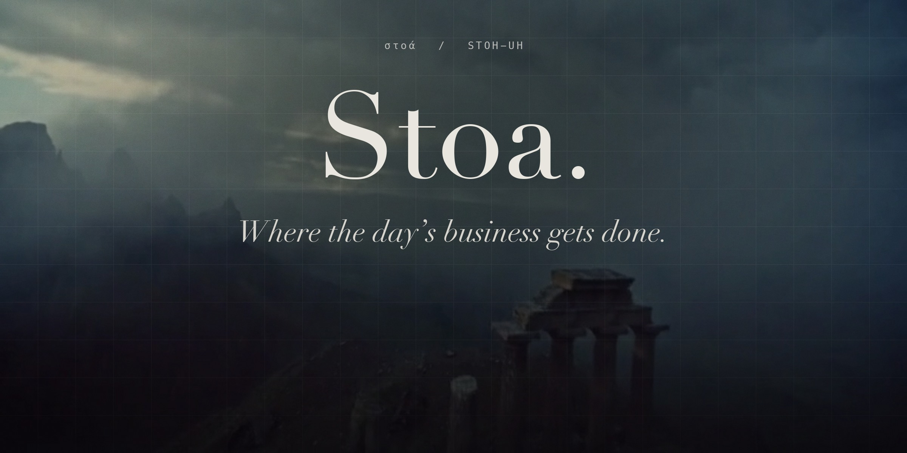

# Stoa

**The CRM for [Hermes Agent](https://github.com/NousResearch/hermes-agent): a lightweight one you talk to. Hermes runs it; you approve.**


A two-person sales team does not need a CRM with forty tabs. It needs to know who to sell to,
the pipeline kept honest, the follow-ups written, and the calls turned into next steps, in the
places the team already works. Tell it what happened, send it a list, or press a button, and it
keeps the pipeline. Stoa is that, in one plugin:

**Map the market → find the leads → run the pipeline.**

- **Map any market.** Tell Hermes what you sell. It segments the market, researches companies,
  scores each against your brief with the evidence, and posts the map. One tap on a company puts
  it in the pipeline and sets Hermes to finding the buyer and drafting the first note.
- **Send it anything.** A PDF of leads, a spreadsheet, a photo of a sign-up sheet. Hermes reads it,
  Stoa shows what it would add and what it would change, and nothing is written until you press Apply.
- **Click a button, the stage changes at once.** No model in the loop, no waiting, no wrong stage.
- **Hermes proposes, you approve.** What it finds in your email, calls and Slack is logged on the
  right record. Anything more (a stage it thinks should move, a person to add) waits for your yes
  or no with the evidence beside it, a no is remembered, and any change can be taken back.
- **Then Hermes does the writing.** The same click hands the follow-up (the outreach note, the
  proposal email, the decline) to the agent, in the card's thread.
- **One file fits it to your business.** A playbook names your stages, your button labels and
  what gets drafted at each step. Recruiting, B2B sales and agency playbooks ship with it, and
  Hermes can interview you and write a new one.

It grew out of a setup a recruiting agency runs its searches on every day. This is that idea,
rebuilt as a plugin anyone can install.

```
hermes plugins install stoa                        # from the Hermes plugin catalog
hermes plugins install jarrett-del/hermes-stoa     # or straight from this repository
hermes plugins enable stoa
hermes stoa demo saas     # optional: look around a worked example first (or: hermes stoa demo recruiting)
hermes gateway restart    # so the Slack buttons bind
```

Then, in any Hermes chat: *"Map the market for us"*, *"What's on my plate?"*, or `/gtm`.
In Slack the command is `!gtm` (Slack keeps the slash for its own commands), and
`!gtm Dana Whitfield` or `!gtm map` posts the card or the map itself, buttons included.

## Any pipeline, and two worked examples

A playbook describes a pipeline: what a record is called, the stages it moves through, what the
buttons say, and what Hermes drafts at each step. It can be any pipeline. Four playbooks ship:
clients and revenue (`b2b-sales`, the default), recruiting and search (`recruiting`), agency and
consulting (`agency`), and partnerships and fundraising (`partnerships`). Hermes will write one
for your business from a short conversation.

The first time you open the page it asks how you sell, and offers a look around first:

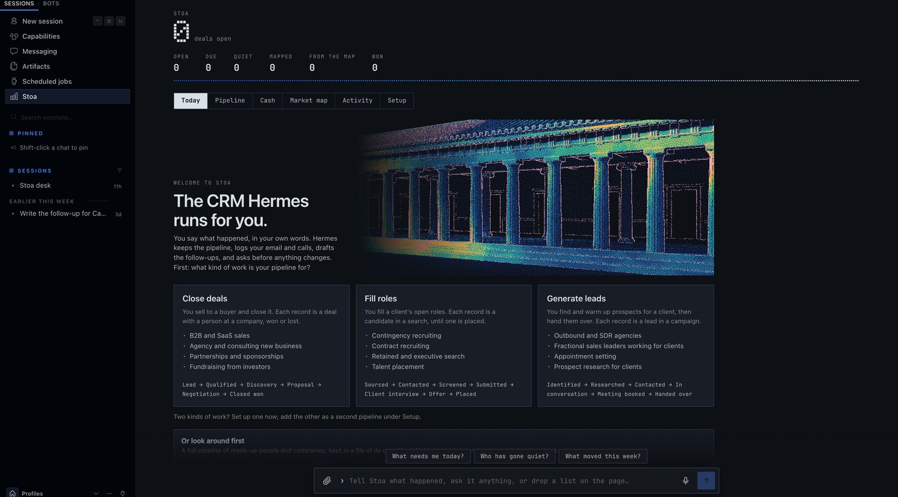

The sample data shows two businesses at a realistic size. Everything in it is made up.

| | A recruiting agency | A B2B software company selling a fraud prevention tool |
|---|---|---|
| **Tour it** | `hermes stoa demo recruiting` | `hermes stoa demo saas` |
| **A record is** | a candidate in a client's search | a deal with a buyer at an account |
| **Stages** | Sourced → Contacted → Screened → Submitted → Client interview → Offer → Placed | Lead → Qualified → Discovery → Proposal → Negotiation → Closed won |
| **On the desk** | 24 open candidates across 8 searches, **$1.2M** in fees, plus 3 placed and 5 passed | 28 open deals, **$2.5M**, plus 4 won and 6 lost |
| **Its market map** | Where the candidates for one search work now: 10 companies, and adding one puts its named person in that search | Fintechs and marketplaces exposed to payment fraud: 14 companies, what each uses today, and who to call first |

A tour never touches your own desk. The sample data lives in a file of its own, with its own
playbook; every surface says it is sample data while it is on show; lookups are off and scheduled
jobs wait. **Leave the tour** on the page, or `hermes stoa demo --leave`, brings your desk back
exactly as it was and throws the sample file away. (Versions before 0.10 loaded the examples into
the desk itself. If yours did, the Setup tab offers to take them out, and so does `--leave`.)

The recruiting agency:

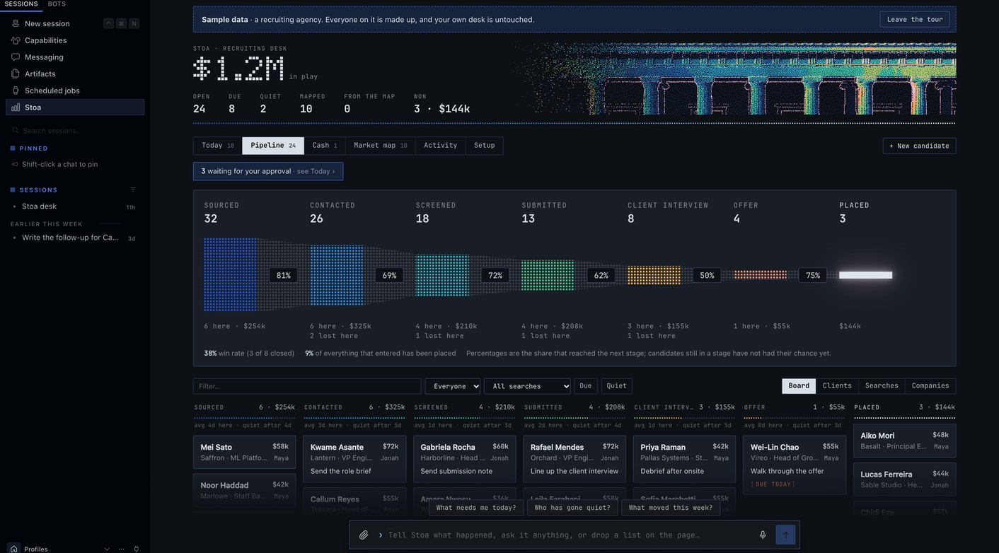

The company selling a fraud prevention tool:

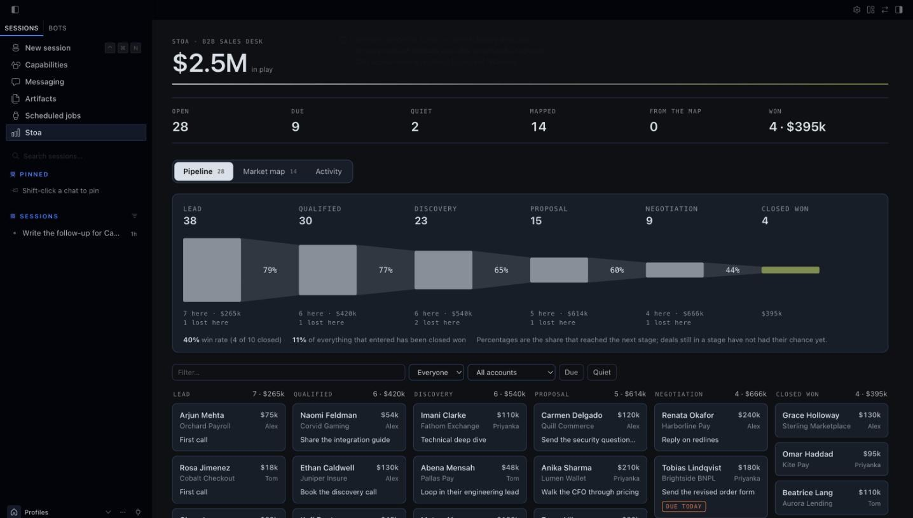

## Talk to it, and watch the desk change

In the Hermes Desktop app and the Webapp, Stoa sits beside the conversation.

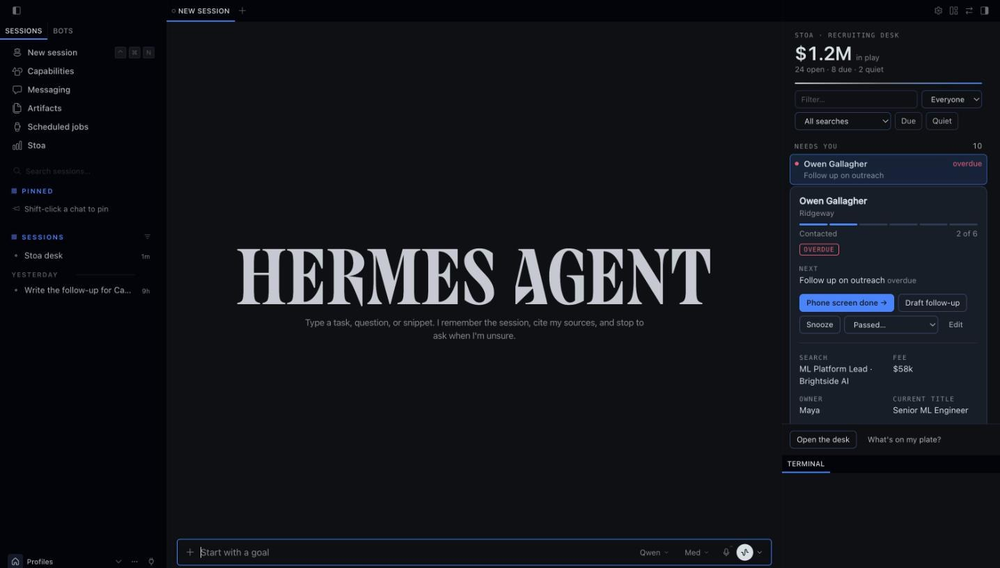

- **A pane beside the chat.** What needs you today, every stage, the first calls from your map.
  Tell Hermes *"I spoke to Marcus, follow up Thursday"* and the pane redraws as the agent saves it.
  Narrow it by owner, by search or account, to what is due or what has gone quiet, or by any text.
- **A click saves, then Hermes writes.** Press **Draft follow-up** or the stage button on a
  record. The change is saved at once, one line goes into the open chat as if you had typed it,
  and the draft comes back in the conversation.
- **Cards in the conversation.** Ask *"show me Dana"* and the reply contains the live card, with
  its buttons, not a description of it. *"Show me the market map"* draws the map the same way.
- **A page of its own.** **Stoa** in the sidebar opens on **Today**, then the funnel with its
  conversion rates and the pipeline board with the same filters, the market map with its reading,
  the activity log, and **Setup**.
- **Today.** What needs you, most pressing first: what is waiting for your approval, next steps
  overdue and due today, records gone quiet, and new ones with nothing planned. Each row has one move.
  **Done** logs the step and asks what comes next, **Draft it** has Hermes write what the step
  needs, **Snooze** puts it aside for a few days or until a date you pick, and until then it is on
  no list. What is coming up this week sits beside it.

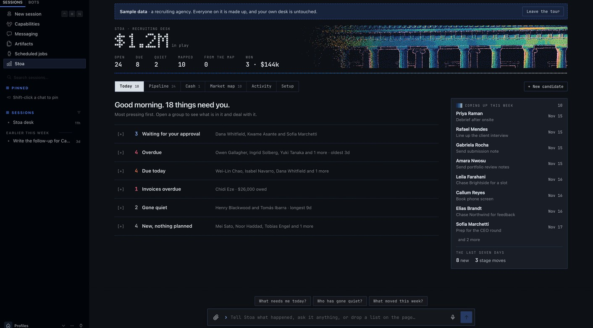

- **Approvals.** Whatever Hermes suggests on its own sits at the top of Today, one card each:
  what would change, why, and what it rests on (the email, the call, in their words). **Approve**
  writes it; **Decline** leaves the desk as it is, and the same suggestion is not made again. A
  list you were sent is reviewed there too, as a whole.
- **Undo.** Every change records what it replaced. After anything you do, **Undo** appears above
  the box at the foot of the page; a record's log and the Activity tab offer it for the last
  change on each record, whoever made it, you, Hermes or a button in Slack.

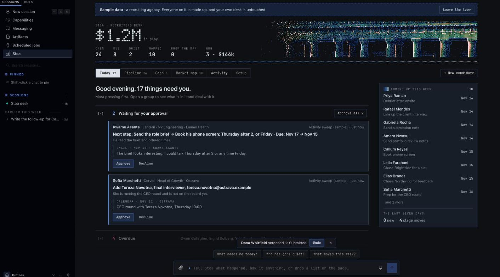

- **People and companies.** A record has its own person and can carry the others around it: the
  buyer's boss, finance, a hiring manager. Their email and calls are then filed on that record
  too. Press the company on a record, or **Companies** on the pipeline, for everything at one
  company: its records, everyone known there, what is open and won, and the notes you keep on it.

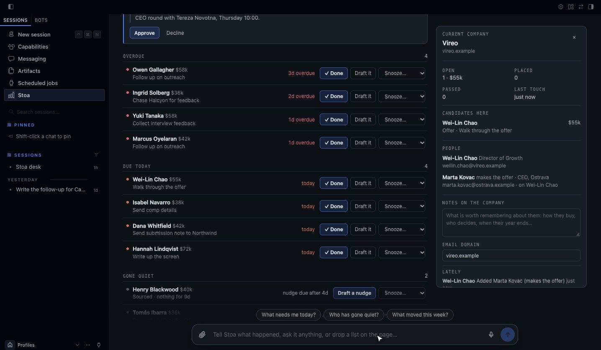

- **Setup.** One tab that says where things stand: a short get-started list that ticks itself off,
  what is connected (a key shows as set or not set, never its value), the rules in force (which
  chats the desk answers in, who may press a Slack button, which folders it reads), the
  automations you can switch on, your playbook and the others, your data with a CSV export, and a
  cheat sheet of things to say, press and type.

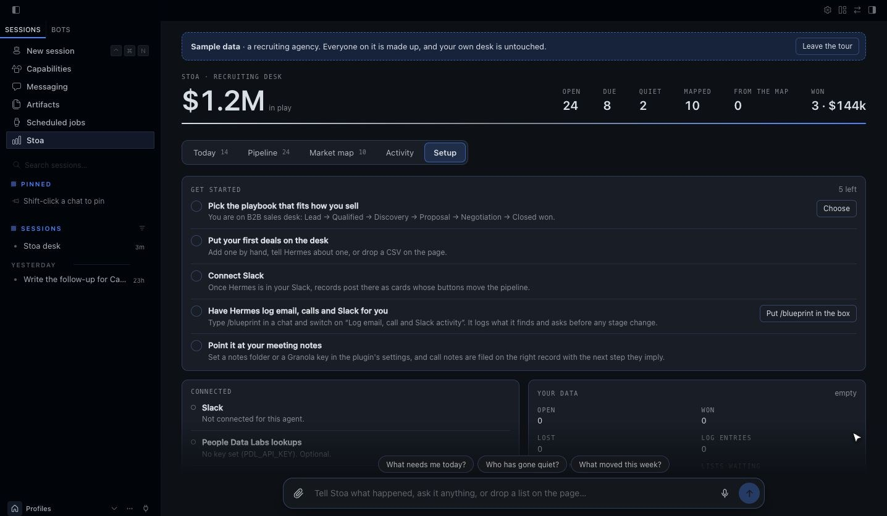
- **Talk to the page.** A dock at the foot of the page takes the same sentences the chat does:
  *"Add Nadia Rahim from Larkspur to the Northwind search"*, *"what needs me today?"*. The
  conversation opens above the dock and the board redraws behind it. The page keeps its own
  conversation for this, called **Stoa desk**, listed in the sidebar like any other, one click
  away when you want the full chat.
- **Say it or hand it over.** The microphone dictates into the dock where the browser has speech
  recognition. Drop a CSV anywhere on the page, or attach one, and the desk reads it itself and
  shows the review, with no model in between. A small text file goes along with your message.
- **Or do it by hand.** Drag a card to another column to move it. **+ New** adds a record from a
  short form. **Edit** on any record changes its next step, stage, value, owner and the rest, and
  adds a line to its log. Press a stage in the funnel to pick out its column on the board. No model involved.

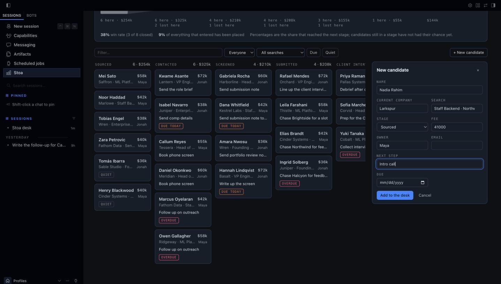

- **Lists you send in.** Drop a file into the chat. The review appears in the conversation and in
  the pane: a tick box per row, what each one would add or change, and one **Apply** button.

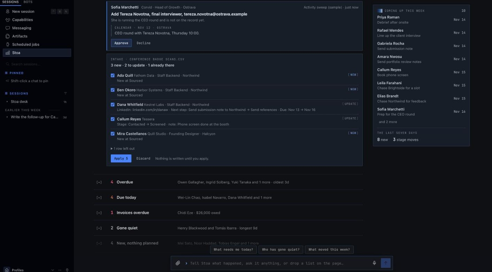

Switch it on once under **Capabilities → Plugins → Stoa**. Every colour comes from the app's own
theme, accent included, so it looks like part of Hermes in whatever theme you run.

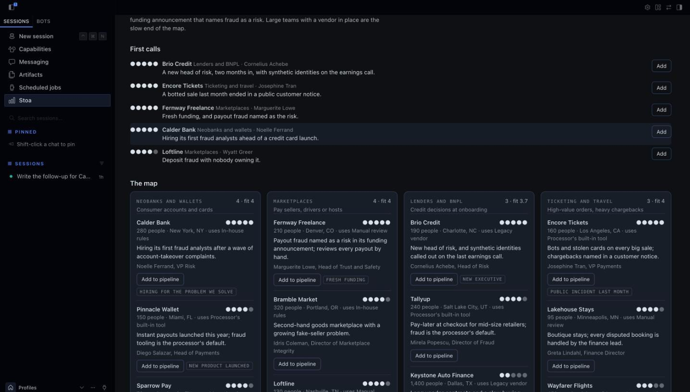

## The web dashboard tab

Stoa also adds a tab to the Hermes web dashboard (`hermes dashboard`). It refreshes every few
seconds, so when someone taps a button in Slack you watch the card move. If the dashboard was
already running when you installed Stoa, restart it once and the tab appears.


- **The number that matters, live:** what is in play, beside mapped → leads → in play → won,
  with what is due and what has gone quiet underneath.
- **Funnel:** how many records reach each stage, the share that moves on to the next, what is
  sitting in each stage and where records are lost, with the win rate beneath it.
- **Pipeline board:** a column per playbook stage. Open a card to see its log, set the next
  step, log a call, advance it, close it with a reason, or snooze it.
- **Market map:** every segment as a cluster, each company sized by fit and filled in once it
  is in the pipeline, with the map's reading beneath it: requirement rarity, who holds the
  market, first calls, where segments meet, and a flow diagram from segment to what each
  company uses today. Open a company for its requirements checklist, buyers and source, then
  **Add to pipeline**. **Download page** saves the map as a web page.
- **Activity:** everything that happened, from Slack clicks, the agent and the web alike.
- **Setup:** what is connected, the rules in force, sample data and the playbook switch.
- **The dashboard's own look.** The tab takes its colours, type, square corners and hairlines
  from the dashboard's theme, so it reads as one of its pages in whichever theme you run.

The newer work (Today, approvals, undo, people and companies) is in the Desktop app and Webapp
page; the dashboard tab is the pipeline, the map and the log.


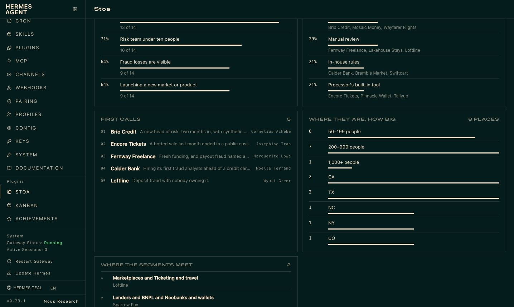

Buttons on the web do the same instant, deterministic work as the buttons in Slack. The web
cannot start an agent turn, so when a click calls for a draft the task waits on the record
(the card shows *draft waiting*) and Hermes writes it the next time that record comes up in chat.


## What it looks like in chat

A card in Slack (shown here as the text version every other surface gets):

```
Dana Whitfield · Kestrel Labs
▰▰▰▱▱▱  Screened · 3 of 6
Search: Staff Backend · Northwind
Fee: $42k
Current title: Senior Backend Engineer
Comp expectation: $210k base
Next: Send submission note to Northwind (due 2026-11-10)

[ Submit to client ]  [ Draft follow-up ]  [ Enrich ]  [ Passed… ▾ ]  [ ⋯ ]
```

Press **Submit to client** and three things happen, in this order:

1. The record moves to *Submitted* and the activity log records who clicked. Instant, in SQLite.
2. The card redraws itself, in every channel it was posted to.
3. Hermes gets a turn in the card's thread with the playbook's instruction for that stage
   (*"Draft the submission note to the client: three bullet points on fit, comp and
   availability, and one honest risk"*) and replies with the draft.

Two people clicking the same button at once move the stage once, not twice: the check and the
change are one database transaction, so it holds across Slack, the web tab and the agent.

## What you get

| | |
|---|---|
| **10 tools** | `gtm_market`, `gtm_pipeline`, `gtm_deal`, `gtm_contact`, `gtm_card`, `gtm_intake`, `gtm_enrich`, `gtm_notes`, `gtm_playbook`, `gtm_export` |
| **Approvals** | What Hermes suggests waits for your yes or no, one decision each, with its evidence; a no is remembered; a scheduled job changes only what you allow |
| **Undo and a ledger** | Every change is kept with what it replaced, never altered; an action can be taken back unless that would overwrite a later change |
| **People and companies** | Several people on a record, each kept once across records, mail matched to the right record by whoever sent it, and one view per company |
| **Intake** | Send a list in any form; review what is new and what would change; apply what you tick |
| **Market maps** | Segments, fit scores, evidence and sources, with an **Add to pipeline** button per company |
| **Slack cards** | Advance, Draft follow-up, Enrich, close with a reason, snooze, reopen |
| **Desktop app and Webapp** | A live pane beside the chat, a Stoa page (Today, pipeline, companies, market map, activity, setup), and cards and maps drawn inside the conversation |
| **Web dashboard tab** | Live funnel, pipeline board, market map, activity feed, record side panels with actions |
| **`/gtm`** | The board, the brief, a map or one record, on every surface Hermes runs on (CLI, Telegram, Desktop…). In Slack, `!gtm`, where a record or a map arrives with its buttons |
| **`hermes stoa`** | Status, board, brief, map, the ledger (`history`), autonomy, sample data, CSV import and export from a terminal |
| **7 automations** | Morning brief, email-call-and-Slack activity sweep, meeting-notes sweep, weekly market watch, Friday review, mirror to a Google Sheet, bring Sheet edits back, under `/blueprint` |
| **3 skills** | `stoa:desk` (how the agent runs the desk), `stoa:market-map`, `stoa:playbook-authoring` |
| **4 playbooks** | `b2b-sales`, `recruiting`, `agency`, `partnerships`, plus any you or the agent write |

### Market maps

*"We sell a fraud prevention tool to fintechs and marketplaces. Who should we go after?"*

Hermes names the market, splits it into segments that would each get a different pitch, and
agrees a short list of requirements with you: the things a fit company shows. Then it researches
companies for each segment, with its own web search or with [Exa](https://exa.ai) if you add a
key, and checks every one against those requirements. Each company goes on the map with:

- a fit score from 1 to 5, read off the requirements unless Hermes has reason to set it;
- the evidence for each requirement it shows, and the ones it does not;
- a buying signal, what it uses today, and the likely buyers;
- the source link.

```
Market map · Fintechs and marketplaces exposed to payment fraud
14 companies · 1 in the pipeline · 5 with a signal

Lenders and BNPL (3)
  ●●●●● Brio Credit · 190 people · Charlotte, NC  [in pipeline]
        New head of risk, and synthetic identities called out on the last earnings call.
  ●●●●○ Tallyup · 240 people · Salt Lake City, UT
        Pay-later at checkout for mid-size retailers; fraud is the processor's default.

Ticketing and travel (3)
  ●●●●● Encore Tickets · 160 people · Los Angeles, CA
        Bots and stolen cards on every big sale; chargebacks named in a customer notice.
```

The map then reads itself back. This is the part a list of names never gives you:

| | |
|---|---|
| **How rare each requirement is** | The share of checked companies that show each one. A scarce requirement is either too strict or the first question on every call. |
| **Who holds this market today** | What the companies use now. If most review by hand, you are selling against doing it by hand, not a competitor. |
| **Where the segments meet** | Companies that could sit in two segments: the second pool when one runs thin. |
| **Where they are, how big they are** | By region and headcount band. |
| **First calls** | The few to approach first and why, chosen by Hermes or, failing that, the strongest fits spread across segments. |
| **Reading the map** | Hermes's short interpretation and what to do about it, saved with the map. |

A map does not have to be of customers. In the recruiting example it is a talent map: the
companies where the candidates for one search work now, each with the people worth approaching.

In Slack each company has an **Add to pipeline** button. A tap creates the record at the first
stage of your playbook with the first known buyer as the contact, carries the evidence into its
activity log, and asks Hermes to confirm the buyer (or find one) and draft a first-touch note.
The *Market watch* automation re-checks a map every week and adds at most five new companies.

**A page to send.** `gtm_market(action="export")`, or **Download page** in the web tab, writes the
whole map as one self-contained web page: no scripts, no outside requests, nothing to host. The
share version leaves out buyers' names and what is in your pipeline.

### Intake

*"Here's the attendee list from the conference."* (with a PDF attached)

Hermes reads the file and hands Stoa the rows. Stoa then works out, with no model involved, what
each row would do:

| | |
|---|---|
| **New** | Nobody like this on the desk. It would be added at the first stage, or the stage the file gives. |
| **Update** | Already on the desk, and the file knows something the record does not, or says something different. Every change is listed: `stage Contacted → Screened`, `LinkedIn added`. |
| **Already there** | On the desk with nothing new. Left alone. |
| **Unclear** | Could be more than one record. Stoa asks which. |

A person is matched by email first, then LinkedIn, then name and company. The same person in a
different account or search is a new record, not an update. Nothing is written until you press
**Apply** in the app or in Slack, or say "apply all but 3". Two people pressing Apply write the
list once. A CSV on disk is read by the desk itself, in Excel's encoding too.

### The pipeline

Everything lives in one SQLite file under `<hermes home>/plugin-data/stoa/desk.db`: records,
the people on them, their activity log, which cards were posted where, and the enrichment cache.
It is per profile, it survives plugin updates, and you can open it with any SQLite tool.

- **A ledger of every change.** Beside the log a person reads, the file keeps a ledger: one line
  per change to a record or a person, with who made it, what it replaced and what it left. The
  database itself refuses to alter or remove a line, so it is the account of what happened, and
  it is what Undo reads. `hermes stoa history [record]` prints it.
- **Money in whole cents.** Amounts are stored as integers and added up as integers, so a
  pipeline total is exact. (The old decimal column is still written beside it, so an older
  version of the plugin can read the same file.)
- **Nothing a person does destroys a record.** Taking back an add takes the record off the
  desk and keeps it; *"bring Ada back"* (`gtm_deal(action="restore")`) returns it with its log.

Talk to it in plain language. *"Add Dana from Kestrel to the Northwind search." "I spoke to
Marcus, he wants 210 base, follow up Thursday." "We lost Lumen on price."* The agent writes each
of those to the desk in the same turn; the bundled skill teaches it to treat the desk, not its
memory, as the source of truth.

Every record carries one next step and a date. *"What needs me today?"* (or `/gtm today`) answers
with the same list the Today tab shows. *"Done, I sent the references"* logs the step and sets
the next one. *"Park Kestrel until the 20th"* snoozes it: a snoozed record is on neither the due
list nor the quiet list, in the page, the morning brief or Slack, until its date.

### Approvals, autonomy and undo

In a chat you are there, so Hermes does what you ask. The rest is for when you are not.

- **A scheduled job cannot outrun you.** The desk has one setting, changed only on the Setup tab
  or with `hermes stoa autonomy <ask|routine|full>`: no tool can change it, so the agent cannot
  raise it. **Ask me first** (the default): a job may log what it finds, and every other change
  waits for you. **Handle the routine**: it may also set next steps, fill in facts and add people
  to a record. **Run it**: it may make any change. This is enforced in the plugin, not in the
  prompt: a change the setting does not allow is not made, it becomes a proposal.

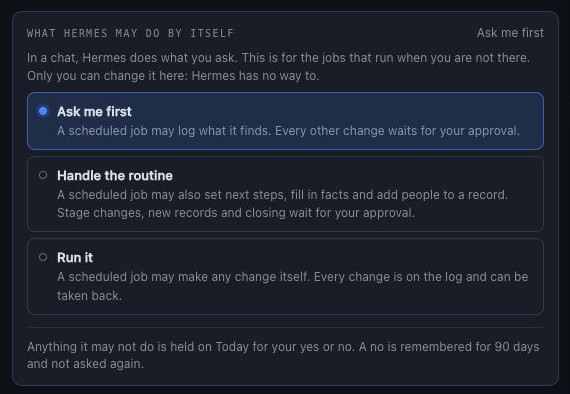

- **A proposal carries its case.** The record, what would change, one line of why, and up to four
  pieces of evidence: an email, a call, a message, with who and when and their words. You approve
  or decline each on Today (or apply a whole list at once). Approving is a person's: a scheduled
  job cannot apply or discard what is waiting.
- **A no is remembered.** A declined proposal is kept for 90 days and the same one is left out
  if it comes again. It is the same one only while the record has not moved: once the stage or
  the value it would replace changes, it counts as new. **Forget them** on Setup clears the memory.
- **Everything can be taken back.** One action (a click, a tool call, an approved proposal) is
  undone as one: *"undo that"*, the Undo offer on the page, or `gtm_deal(action="undo")`. It takes
  back the last action on a record, then the one before. An undo never overwrites a later change:
  if something the action set has been changed again since, nothing is taken back and you are told
  what stands in the way (*"Deal size is now $60k; that action left it at $50k"*). An earlier
  action whose values are untouched still goes back, whatever was logged after it. Undoing an add
  takes the record off the desk, and it can be put back.

### People and companies

*"Add their CFO, Lena Ortiz, to the Kestrel deal." "Who do we know at Kestrel?" "What do we have
going with Northwind?"* A record keeps its own person and any number of others. A person is kept
once and linked to each record they are on: add someone by an email the desk already knows and
they are linked, not entered twice; their title and email are theirs everywhere, and their role
is their part in one record. `gtm_contact(action="match")` tells the agent whose an email address
is: the record it belongs to, through anyone on it, or, for a stranger, the company their domain
belongs to and that company's open records, so a sweep files mail in the right place and can
propose adding the sender. A company is not something you set up: it is every record that names
it, however the name is written ("Kestrel Labs, Inc." and "kestrel labs" are one), plus the notes
and the email domain you keep on it.

### Playbooks

A playbook is a short YAML file:

```yaml
name: recruiting
terms: {deal: candidate, deals: candidates, group: search, groups: searches, value: Fee}
stages:
  - {id: screened, label: Screened, stale_days: 3, advance: Submit to client}
  - {id: submitted, label: Submitted, stale_days: 4, advance: Client interview}
won:  {id: placed, label: Placed}
lost: {id: passed, label: Passed, reasons: [Not a fit, Comp mismatch, Client passed]}
drafts:
  on_enter:
    submitted: >
      Draft the submission note to the client for {name}: three bullet points on fit, comp and
      availability, and one honest risk. Quote only what is in the notes.
```

`stale_days` decides when a record counts as gone quiet at that stage. `advance` is the label on
the button. `drafts.on_enter` is what Hermes writes when a record arrives at a stage. An optional
`door` is the short name the first-launch chooser shows for it.

To make your own, tell Hermes how you sell: *"We install commercial solar. Set the desk up for
us."* It asks a few questions, shows you the stages, and saves the playbook. Or copy one from
[`playbooks/`](playbooks/) into `<hermes home>/plugin-data/stoa/playbooks/` and edit it.

### Meeting notes

Point `notes_dir` at any folder of Markdown or text call notes (an Obsidian folder, the export
folder of an open-source meeting recorder, files you drop in by hand), or add a Granola API key.
`gtm_notes` lists the notes that have not been filed and which record each one is probably
about. The agent reads a note, files a short summary on the right record with the next step,
and recommends a stage change for you to confirm. The *File meeting notes* automation does this
a few times a day.

### Enrichment

With a [People Data Labs](https://www.peopledatalabs.com/) key, the **Enrich** button and
`gtm_enrich` look up a person or company and fill the record's blank fields. It never overwrites
what a person typed, results are cached for 90 days, and a monthly cap (default 50 lookups)
keeps the bill predictable. A playbook with `enrich: none` removes the button and refuses the
lookup, for teams that do not want it at all.

### Gmail

Stoa writes drafts and never sends. When the Google Workspace skill (or any Gmail tool) is
connected to Hermes, the agent saves what it drafts as a Gmail draft addressed to the record's
email, ready for you to read and send. Without it, drafts arrive in the chat.

### Email, calls and Slack, logged for you

Switch on the *Log email, call and Slack activity* automation and, a few times a day, the agent
looks through whatever you have connected to Hermes (Gmail, a calendar or call recorder, Slack)
for anything that happened with the people on the desk.

- **It logs what it finds** on the right record, as a one or two sentence summary. Each email,
  message or call is logged once, however often the sweep runs.
- **It asks before moving anything.** When an email says the interview is booked or the contract
  is signed, the stage change and the new next step arrive as a review with a tick box per
  record, in Slack or in the app. Nothing moves until you apply it.
- **It proposes newcomers the same way.** Someone who writes in and is not on the desk yet is a
  row in that review, not a record.

Stoa has no mail or chat code of its own and holds no Google or Slack credentials for this: the
agent reads with its own tools, so it sees exactly what your Hermes can already see.

### Google Sheets

Connect Google to Hermes (its Google Workspace skill covers Gmail, Drive, Sheets and Docs) and
the desk can live in a Sheet as well:

- *"Mirror the desk to my Google Sheet."* Hermes writes the whole pipeline to a tab called
  `Stoa`: one row per record, in your playbook's own column names. The *Mirror the desk to a
  Google Sheet* automation keeps doing it a few times a day.
- *"Pull my Sheet edits."* Hermes reads the tab back and Stoa shows what people changed there
  (a stage, a fee, a new row) as a review to approve, the same card as any other list. The
  *Bring Sheet edits back* automation does that once a day.

The records themselves stay in Stoa's own database, which is what keeps a button click instant.
The Sheet is as fresh as its last mirror, and a Sheet edit reaches the desk when you approve it,
not the moment it is typed.

### Spreadsheets

`gtm_export` writes the whole pipeline to a CSV that opens in Google Sheets or Excel, and reads
one back in (with a dry run first). That is how you move in from a spreadsheet, and how you get
a copy out for a board meeting. Import reads the files spreadsheets actually produce: Excel's
encoding, a stray comma in a row, due dates written as `12/01/2026` or `Dec 1`. A row it cannot
use is reported with its row number and the rest still come in.

Due dates are stored as dates. Say "tomorrow", "Friday" or "+3d" and the desk works it out; say
something it cannot read and it tells you, and nothing is saved.

## Settings

All optional. Set them in the Desktop app under **Settings → Plugins → Stoa**, or in
`config.yaml` under `plugins.entries.stoa.settings`.

| Setting | Default | What it does |
|---|---|---|
| `playbook` | `b2b-sales` | Which playbook the desk runs on |
| `channels` | empty | Chat ids where the desk is available; empty means everywhere. Add `cron` to let scheduled jobs use it too. Button clicks are refused outside these chats as well |
| `slack_users` | empty | Slack user ids (they start with `U`) who may press the buttons on any card, review or map. Empty means only the person a card was posted for can press its buttons |
| `import_dir` | empty | A folder the agent may read CSV files from by path, besides the plugin's own `imports/` folder and the working directory |
| `notes_dir` | empty | Folder of call notes to watch |
| `notes_days` | `7` | How far back the notes inbox looks |
| `pdl_monthly_cap` | `50` | Most paid lookups per calendar month (0 = no cap) |
| `PDL_API_KEY` (secret) | empty | Turns on enrichment and buyer lookup |
| `EXA_API_KEY` (secret) | empty | Lets the market map search for companies directly |
| `GRANOLA_API_KEY` (secret) | empty | Adds Granola notes to the inbox |

One permission is worth granting. For a button click to start the agent's writing turn, Hermes
needs to let the plugin queue a message:

```yaml
plugins:
  entries:
    stoa:
      allow_gateway_injection: true
```

Without it everything else still works: the stage moves, the card updates, and the card's thread
gets a line saying *"Saved. Reply here and I'll write it up."*

Hermes lets a plugin continue a conversation a person started, never open one. So a card you
asked the agent for hands its drafts straight back to that conversation. A card that arrived
another way (from `!gtm`, or a scheduled job) waits for your reply in its thread; the task is
picked up the moment you answer.

A click is answered at once and a writing task is never lost. The card says **Drafting…** under
its buttons the moment you press one, and pressing the same button again while that draft is
being written changes nothing. The task is saved on the record before the hand-off and cleared
when the agent opens the record to do it. If no draft turn has started within 45 seconds, the
card changes to **Draft waiting** and the thread is told how to ask.

## Disclosure

What the plugin does that you would want to know before installing it:

- **Network calls.** Only when you add the matching key, and only to three hosts:
  `api.peopledatalabs.com` (the name, email, LinkedIn URL or company of the one record being
  enriched, or a company name and job titles for a buyer lookup), `api.exa.ai` (the search
  phrase for a market-map search) and `public-api.granola.ai` (reads your note list and note
  summaries; transcripts are never requested). No telemetry, no usage reporting, no other
  outbound requests. Research the agent does with its own web tools is Hermes's, not the plugin's.
- **Dictation.** The microphone in the page's dock uses your browser's own speech recognition,
  not anything of the plugin's or the agent's. In Chrome that means the audio goes to Google's
  speech service while you dictate. It listens only while the button is on, and the button is not
  shown where the browser has no speech recognition.
- **Paid lookups.** People Data Labs charges per result. Every lookup counts against
  `pdl_monthly_cap`, and a buyer lookup returns at most five people.
- **Slack.** Cards are posted and updated through the Slack app Hermes is already connected
  with. The plugin never reads, stores or sees the Slack token. A button moves a stage, applies a
  list and can spend a paid lookup, so a press is taken only from the person the card was posted
  for, or, when you list people in `slack_users`, only from them, and only in a chat the desk is
  available in. Anyone else gets a private "Not allowed" and nothing changes.
- **Credentials.** `PDL_API_KEY`, `EXA_API_KEY` and `GRANOLA_API_KEY` are read through Hermes's secret scope
  (`agent.secret_scope.get_secret`). The plugin reads no `.env` or credential file. A button click
  or a web-tab request arrives outside any chat turn; on a gateway serving several profiles the
  plugin then installs its own profile's scope around the read, the way Hermes does for its own
  background work (`set_secret_scope(build_profile_secret_scope(home))`), and removes it after.
- **Desktop app and Webapp.** `desktop/plugin.js` is one file with no build step. It imports only
  the Hermes plugin SDK and React and calls the plugin's own backend (`/api/plugins/stoa/`). After a
  click that calls for writing it sends one line into the open chat through `host.composer.submit`,
  the same as typing it. The dock on the page keeps one conversation of its own, named **Stoa
  desk**: it is created and resumed through the gateway (`host.request`: `session.create`,
  `session.resume`, `prompt.submit`), it is sent only what you type or dictate there (with one line
  of context on its first message, which you can read in that conversation), and the page listens
  to the gateway's events for that conversation alone to show you the reply. A file is read only
  when you pick it or drop it on the page: a CSV's text goes to the plugin's backend to be held as a
  review, and a small text file goes to the agent with your message. It does not touch the app's
  DOM or other plugins' storage, and it checks in with the backend every 30 seconds while open so
  the agent knows a card can be drawn in the conversation.
- **Web dashboard.** The tab's backend adds routes under `/api/plugins/stoa/`, behind the
  dashboard's own sign-in. They read and change the pipeline, start and end a tour of the sample
  data, hand the pipeline to your browser as a CSV download when you press Export, and switch the
  active playbook (the plugin's own `playbook` setting, saved through `ctx.set_config`; where the
  page cannot save it, it asks Hermes to in the dock instead). They call no model and no outside
  service, except that the Enrich button makes the same People Data Labs lookup as in Slack.
- **The Setup tab.** It shows, to anyone signed in to your Hermes, which chats and Slack members
  the desk is limited to, the folders it reads and writes, where its database file is, and whether
  each key is set. It never shows a key or a token.
- **Sample data.** A tour writes two things in the plugin's own data folder: `tour.json`, which
  says a tour is on, and one `tour-<id>.db` holding the made-up records. Both are deleted when
  you leave. While they are there the plugin does not read or write your own `desk.db`, apart
  from counting what is in it for the Setup tab.
- **Files outside the plugin's own data.** It reads Markdown and text files in the folder you
  set as `notes_dir`. By path it reads only `.csv` and `.tsv` files, and only from the plugin's
  own `imports/` folder, the folder you name in `import_dir`, and the working directory when that
  is a project folder; a path the agent passes anywhere else is refused. (At a terminal,
  `hermes stoa import <file>` reads the CSV you name.) It writes nowhere outside its own data
  folder: exports (the pipeline as CSV, a market map as a web page) always go to its `exports/`
  folder, and a file name is all the agent can choose.
- **Messages to the agent.** With `allow_gateway_injection` granted, a button click queues one
  instruction for the agent in the card's thread. The agent drafts; it is told not to send.
- **Stored data.** Names, emails, notes and enrichment results for the people in your pipeline,
  and for the other people you add to a record, sit unencrypted in `plugin-data/stoa/desk.db`.
  Every change is kept on a ledger in that file with the values before and after it, and the
  ledger is never trimmed; a record or a person taken off the desk is archived there, not erased;
  what you declined is kept for 90 days; evidence quoted in a proposal is kept with it. To erase
  someone for good, delete the file or edit it with a SQLite tool. Treat it like the customer
  list it is.
- **What runs without you.** A scheduled job reaches the desk only if you list `cron` in
  `channels`, and then changes only what the autonomy setting allows; the rest is held for you.
- **No shell commands, no background processes, no self-updates, no Python dependencies.**

## Limits in 0.12

- Buttons are Slack-only. Other platforms get the text card, the text map and `/gtm`.
- In the Desktop app and Webapp the half ships switched off, like every plugin's: turn it on under
  **Capabilities → Plugins**. A click there needs an open chat to send its line into; with none
  open, the task waits on the record.
- If your agent already keeps people somewhere else, it may look there first. Naming the desk ("on the Stoa
  desk") or using `!gtm <name>` settles it.
- A map is as good as the research behind it. Fit scores are the agent's judgement against your
  brief; the source link is there so you can check.
- One Slack workspace per profile.
- The Google Sheet is a mirror, not the database: it updates when Hermes mirrors it, and edits made
  in it come back when you approve them. Deleting a row in the Sheet does not remove the record.
- After updating the plugin, restart the gateway so the Slack buttons bind to the new code.
- A team shares one desk. There are owners on records, but no per-person permissions.
- A card posted by a scheduled job, or before 0.9, has no one on record as having asked for it:
  list the people who may press such cards in `slack_users`, or ask for the card again.
- The activity sweep is only as good as the tools your Hermes has connected and the model reading
  the mail. It summarises; check the record's log against the email when it matters.
- Setup cannot tell which automations you have switched on, so it lists them all and says how.
  Today, approvals, undo, people and companies are in the Desktop app and Webapp page; the web
  dashboard tab has the pipeline, the map, the log and Setup.
- The autonomy setting governs scheduled jobs. In a chat the agent can still change something you
  did not ask for; the skill tells it to propose instead, and whatever it does can be taken back.
- Undo covers changes made since 0.12, when the ledger began. Changes to a market map, notes on
  a company, and a proposal you declined are not undone by it.
- A record's own person (its name and email) is not yet a shared contact: the same buyer on two
  deals is linked only where they were added as an extra person. The company view shows both.
- The ledger grows for as long as the desk is used. It is small, and nothing prunes it.
- A proposal is as good as the evidence the agent quotes. Read it before you approve.
- On a tour, what you do is thrown away when you leave, Slack cards posted from it stop working,
  lookups are off, and scheduled jobs do nothing until it ends.
- The dock on the page runs a turn of your agent's model, the same as typing in a chat. It takes
  CSV and small text files; a PDF, an image or a spreadsheet goes through the full chat, which is
  one click away. Dictation is not available in the Desktop app; the full chat's microphone is.

## Development

Standard library only. The desk logic has no Hermes imports, so the tests run anywhere:

```
python3 -m unittest discover -s tests     # 191 tests, no network
hermes plugins validate . --install-deps
hermes plugins doctor . --ci
```

| File | What it holds |
|---|---|
| `__init__.py` | `register(ctx)`: tools, Slack handlers, `/gtm`, CLI, blueprints, skills |
| `desk.py` | Everything the desk can do |
| `store.py` | The SQLite ledger |
| `playbook.py`, `playbooks/` | Playbook loading, validation, and the built-ins |
| `cards.py` | Block Kit cards and their text twins |
| `slackdesk.py` | Posting cards and answering button clicks |
| `intake.py` | Lists sent in: matching rows to records, the review, and applying what was approved |
| `market.py` | Market maps: segments, requirements, what the map adds up to, and the step into the pipeline |
| `page.py` | A market map as one self-contained web page |
| `sources.py` | People Data Labs, Exa and meeting-note sources |
| `dashboard/` | The web tab: `plugin_api.py` (routes, shared with the app half), `dist/index.js` and `dist/style.css` (hand-written, no build step) |
| `desktop/plugin.js` | The Desktop app and Webapp half: the pane, the page, and the card and map drawn in a conversation |

## License

MIT
