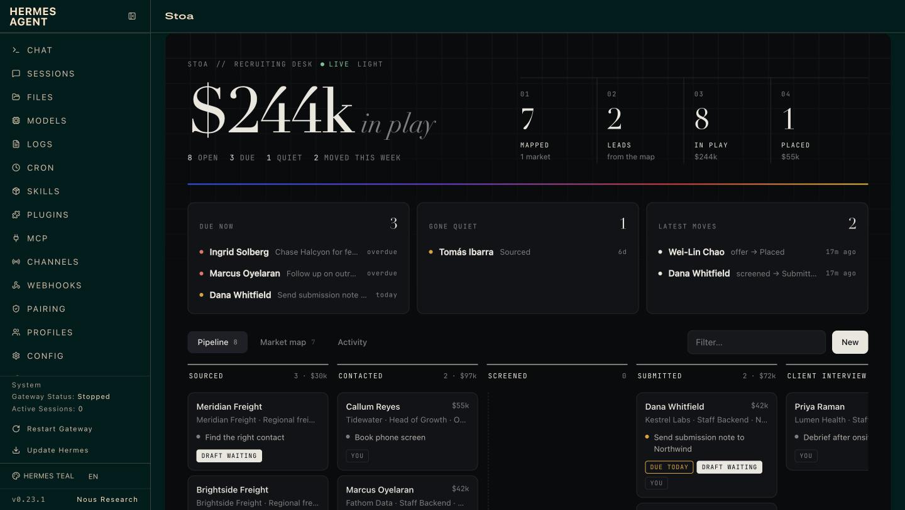
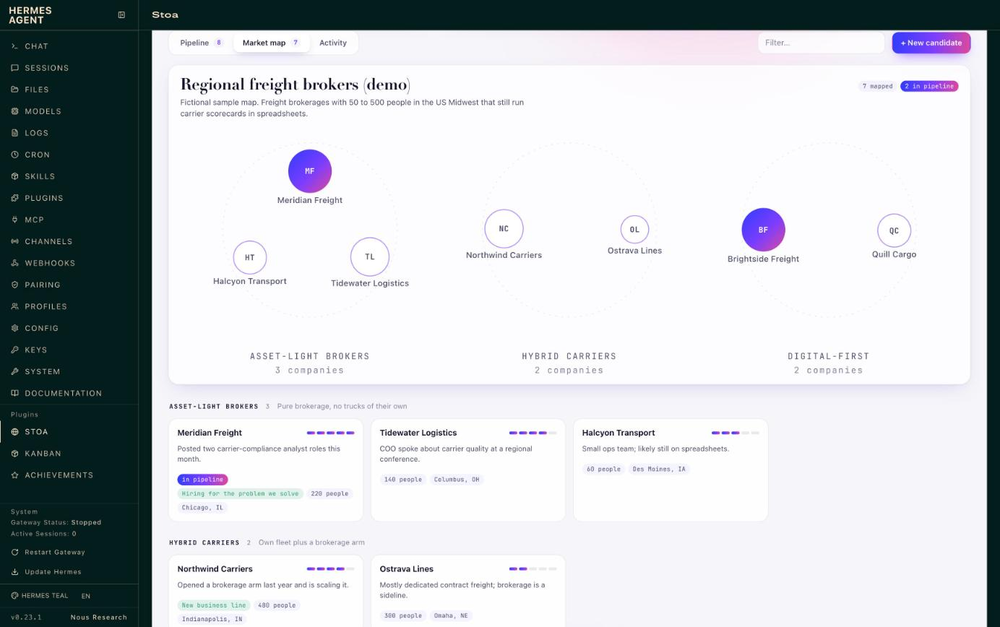
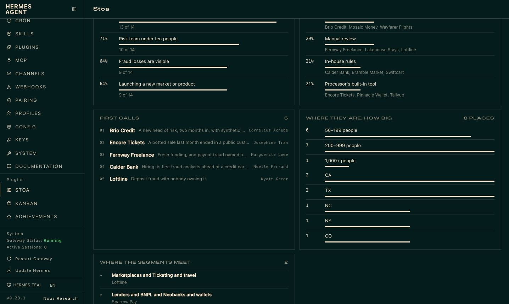
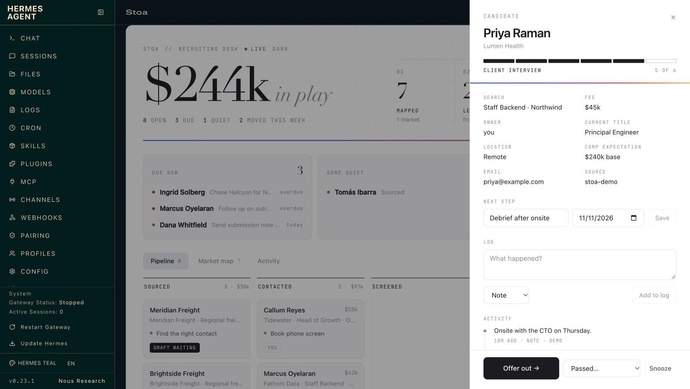

# The web dashboard tab

> This tab is frozen at what it showed in 0.13: the pipeline, the market map, activity and setup. Approvals, cash,
> and searches or accounts are on the Stoa page in the Desktop app and the Webapp, where new work goes.

Stoa also adds a tab to the Hermes web dashboard (`hermes dashboard`). It refreshes every few
seconds, so when someone taps a button in Slack you watch the card move. If the dashboard was
already running when you installed Stoa, restart it once and the tab appears.

- **The number that matters, live:** what is in play, beside mapped → leads → in play → won,
  with what is due and what has gone quiet underneath.
- **Funnel:** how many records reach each stage, the share that moves on to the next, what is
  sitting in each stage and where records are lost, with the win rate beneath it.
- **Pipeline board:** a column per playbook stage. Open a card to see its log, set the next
  step, log a call, advance it, close it with a reason, or snooze it.
- **Market map:** every segment as a cluster, each company sized by fit and filled in once it
  is in the pipeline, with the map's reading beneath it: requirement rarity, who holds the
  market, first calls, where segments meet, and a flow diagram from segment to what each
  company uses today. Open a company for its requirements checklist, buyers and source, then
  **Add to pipeline**. **Download page** saves the map as a web page.
- **Activity:** everything that happened, from Slack clicks, the agent and the web alike.
- **Setup:** what is connected, the rules in force, sample data and the playbook switch.
- **The dashboard's own look.** The tab takes its colours, type, square corners and hairlines
  from the dashboard's theme, so it reads as one of its pages in whichever theme you run.

The newer work (Today, approvals, undo, people and companies) is in the Desktop app and Webapp
page; the dashboard tab is the pipeline, the map and the log.

Buttons on the web do the same instant, deterministic work as the buttons in Slack. The web
cannot start an agent turn, so when a click calls for a draft the task waits on the record
(the card shows *draft waiting*) and Hermes writes it the next time that record comes up in chat.

