# Using Stoa

How the desk works day to day. For everything in the plugin, tool by tool, see [the reference](reference.md); for what it does not do yet, [the limits](limits.md).

## Any pipeline, and two worked examples

A playbook describes a pipeline: what a record is called, the stages it moves through, what the
buttons say, and what Hermes drafts at each step. It can be any pipeline. Four playbooks ship:
clients and revenue (`b2b-sales`, the default), recruiting and search (`recruiting`), agency and
consulting (`agency`), and partnerships and fundraising (`partnerships`). Hermes will write one
for your business from a short conversation.

The first time you open the page it asks how you sell, and offers a look around first:

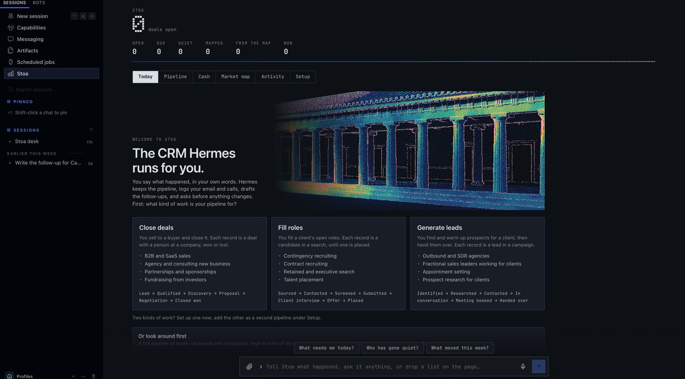

The sample data shows two businesses at a realistic size. Everything in it is made up.

| | A recruiting agency | A B2B software company selling a fraud prevention tool |
|---|---|---|
| **Tour it** | `hermes stoa demo recruiting` | `hermes stoa demo saas` |
| **A record is** | a candidate in a client's search | a deal with a buyer at an account |
| **Stages** | Sourced → Contacted → Screened → Submitted → Client interview → Offer → Placed | Lead → Qualified → Discovery → Proposal → Negotiation → Closed won |
| **On the desk** | 24 open candidates across 8 searches, **$1.2M** in fees, plus 3 placed and 5 passed | 28 open deals, **$2.5M**, plus 4 won and 6 lost |
| **Its market map** | Where the candidates for one search work now: 10 companies, and adding one puts its named person in that search | Fintechs and marketplaces exposed to payment fraud: 14 companies, what each uses today, and who to call first |

A tour never touches your own desk. The sample data lives in a file of its own, with its own
playbook; every surface says it is sample data while it is on show; lookups are off and scheduled
jobs wait. **Leave the tour** on the page, or `hermes stoa demo --leave`, brings your desk back
exactly as it was and throws the sample file away. (Versions before 0.10 loaded the examples into
the desk itself. If yours did, the Setup tab offers to take them out, and so does `--leave`.)

The recruiting agency:

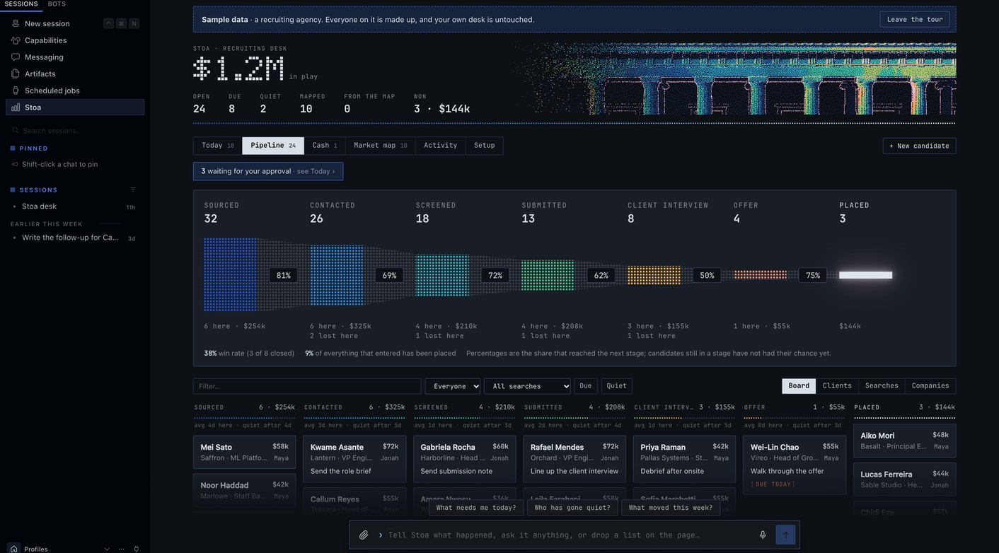

The company selling a fraud prevention tool:

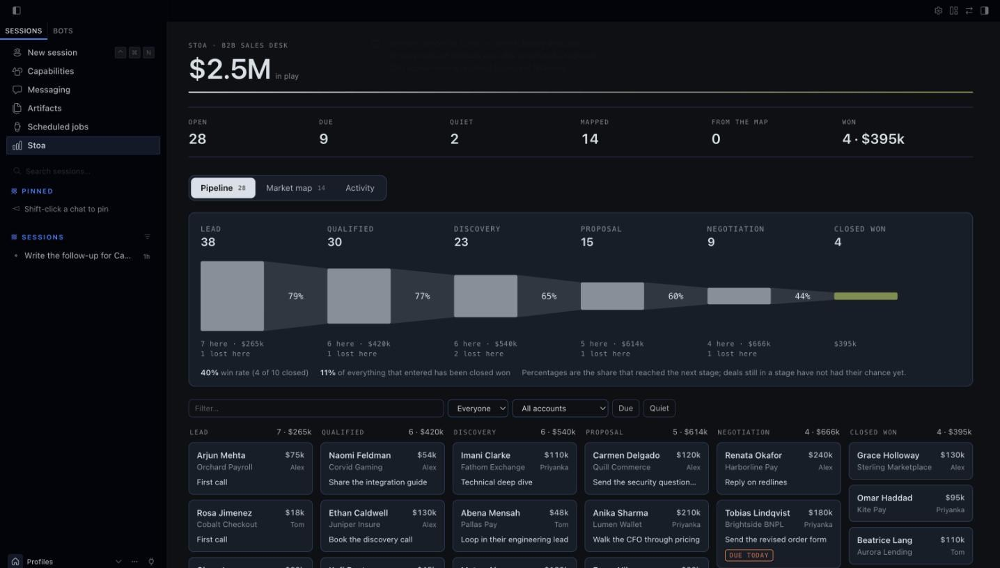

## Talk to it, and watch the desk change

In the Hermes Desktop app and the Webapp, Stoa sits beside the conversation.

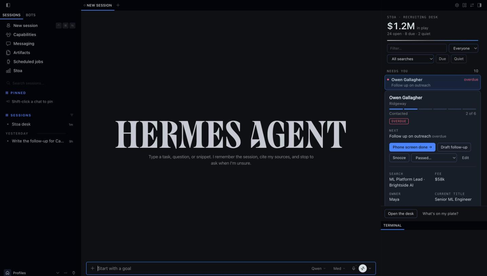

- **A pane beside the chat.** What needs you today, every stage, the first calls from your map.
  Tell Hermes *"I spoke to Marcus, follow up Thursday"* and the pane redraws as the agent saves it.
  Narrow it by owner, by search or account, to what is due or what has gone quiet, or by any text.
- **A click saves, then Hermes writes.** Press **Draft follow-up** or the stage button on a
  record. The change is saved at once, one line goes into the open chat as if you had typed it,
  and the draft comes back in the conversation.
- **Cards in the conversation.** Ask *"show me Dana"* and the reply contains the live card, with
  its buttons, not a description of it. *"Show me the market map"* draws the map the same way.
- **A page of its own.** **Stoa** in the sidebar opens on **Today**, then the funnel with its
  conversion rates and the pipeline board with the same filters, the market map with its reading,
  the activity log, and **Setup**.
- **Today.** What needs you, most pressing first: what is waiting for your approval, next steps
  overdue and due today, records gone quiet, and new ones with nothing planned. Each row has one move.
  **Done** logs the step and asks what comes next, **Draft it** has Hermes write what the step
  needs, **Snooze** puts it aside for a few days or until a date you pick, and until then it is on
  no list. What is coming up this week sits beside it.

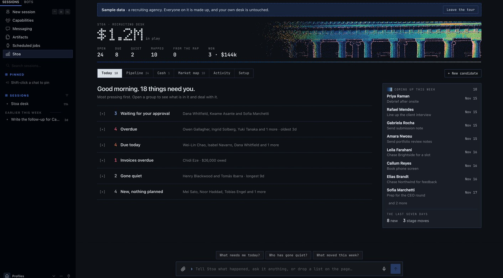

- **Approvals.** Whatever Hermes suggests on its own sits at the top of Today, one card each:
  what would change, why, and what it rests on (the email, the call, in their words). **Approve**
  writes it; **Decline** leaves the desk as it is, and the same suggestion is not made again. A
  list you were sent is reviewed there too, as a whole.
- **Undo.** Every change records what it replaced. After anything you do, **Undo** appears above
  the box at the foot of the page; a record's log and the Activity tab offer it for the last
  change on each record, whoever made it, you, Hermes or a button in Slack.

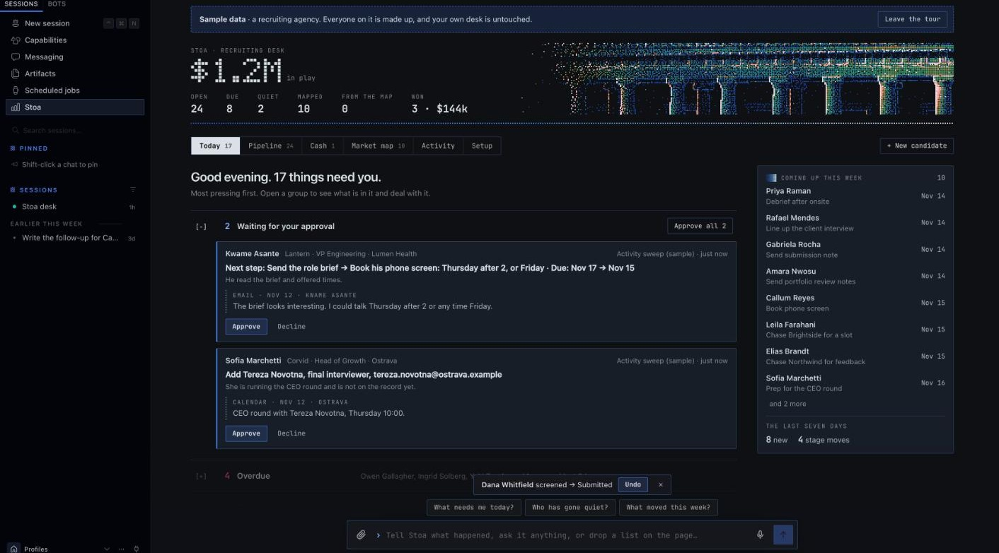

- **People and companies.** A record has its own person and can carry the others around it: the
  buyer's boss, finance, a hiring manager. Their email and calls are then filed on that record
  too. Press the company on a record, or **Companies** on the pipeline, for everything at one
  company: its records, everyone known there, what is open and won, and the notes you keep on it.

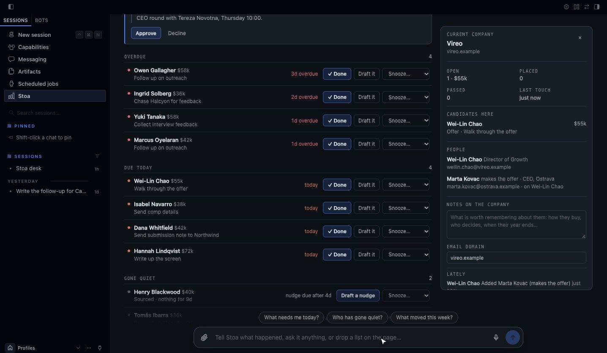

- **Cash.** The other half of lead to cash, on its own tab. Five figures across the top: won this
  month, collected this month, invoiced and not yet paid, overdue, and won but never invoiced.
  Beneath them, what the open pipeline is likely to bring in, weighted by stage and laid out by
  expected close date, with anything past its date called out; where each won piece of work
  stands; and every open invoice with **Paid** and **Part** beside it.

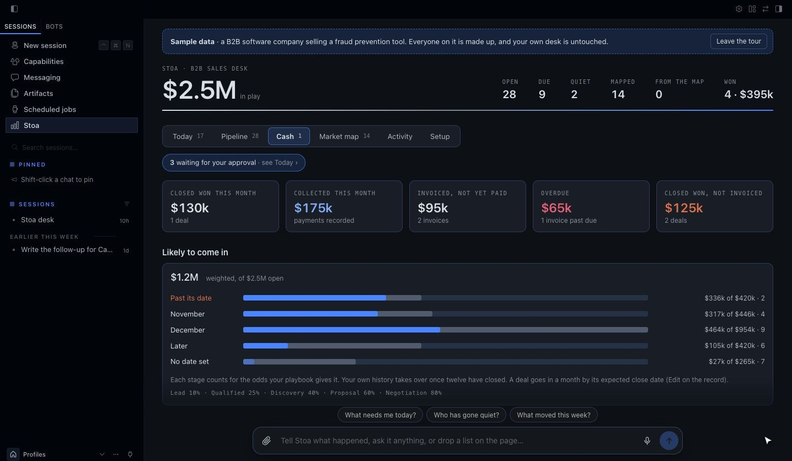

- **Invoices on the record.** A record's **Money** section holds its invoices: the amount, the
  number, when it is due, what has come in. Stoa does not send invoices or take payments; it
  keeps the account, so it can tell you what is late and what you forgot to bill.

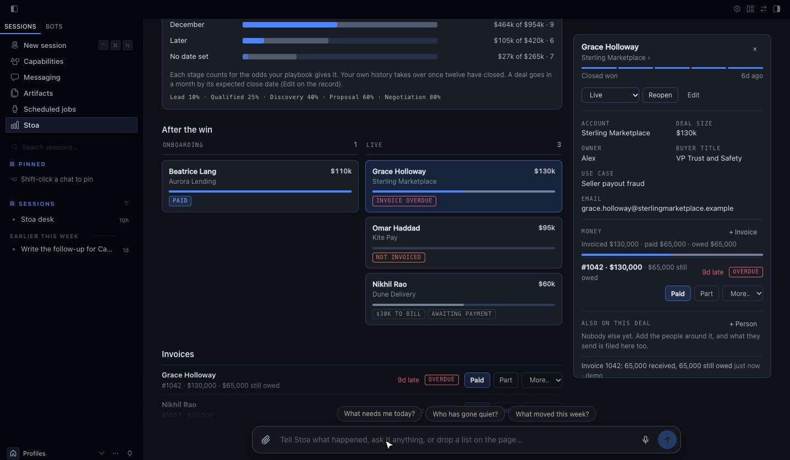

- **Setup.** One tab that says where things stand: a short get-started list that ticks itself off,
  what is connected (a key shows as set or not set, never its value), the rules in force (which
  chats the desk answers in, who may press a Slack button, which folders it reads), the
  automations you can switch on, your playbook and the others, your data with a CSV export, and a
  cheat sheet of things to say, press and type.

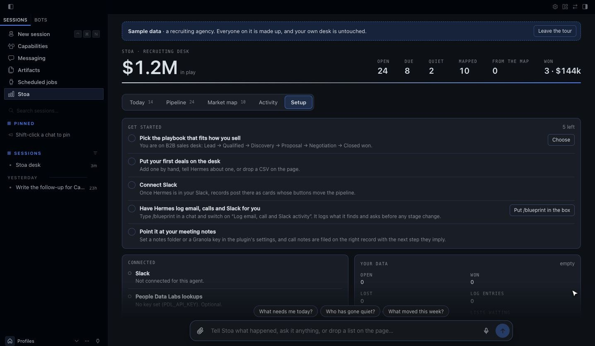
- **Talk to the page.** A dock at the foot of the page takes the same sentences the chat does:
  *"Add Nadia Rahim from Larkspur to the Northwind search"*, *"what needs me today?"*. The
  conversation opens above the dock and the board redraws behind it. The page keeps its own
  conversation for this, called **Stoa desk**, listed in the sidebar like any other, one click
  away when you want the full chat.
- **Say it or hand it over.** The microphone dictates into the dock where the browser has speech
  recognition. Drop a CSV anywhere on the page, or attach one, and the desk reads it itself and
  shows the review, with no model in between. A small text file goes along with your message.
- **Or do it by hand.** Drag a card to another column to move it. **+ New** adds a record from a
  short form. **Edit** on any record changes its next step, stage, value, owner and the rest, and
  adds a line to its log. Press a stage in the funnel to pick out its column on the board. No model involved.

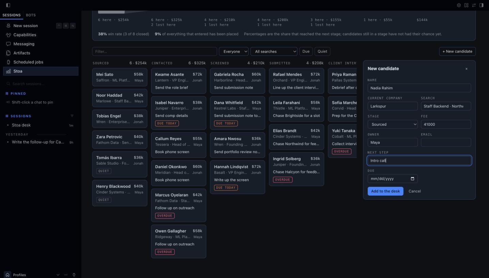

- **Lists you send in.** Drop a file into the chat. The review appears in the conversation and in
  the pane: a tick box per row, what each one would add or change, and one **Apply** button.

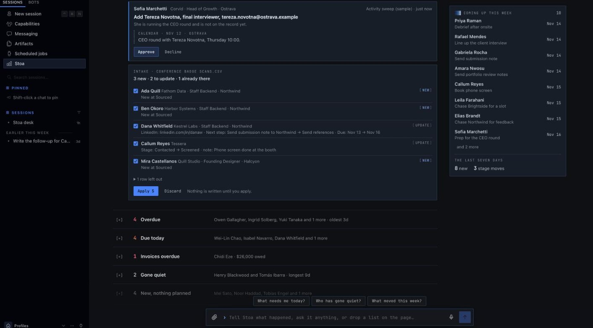

Switch it on once under **Capabilities → Plugins → Stoa**. Every colour comes from the app's own
theme, accent included, so it looks like part of Hermes in whatever theme you run.

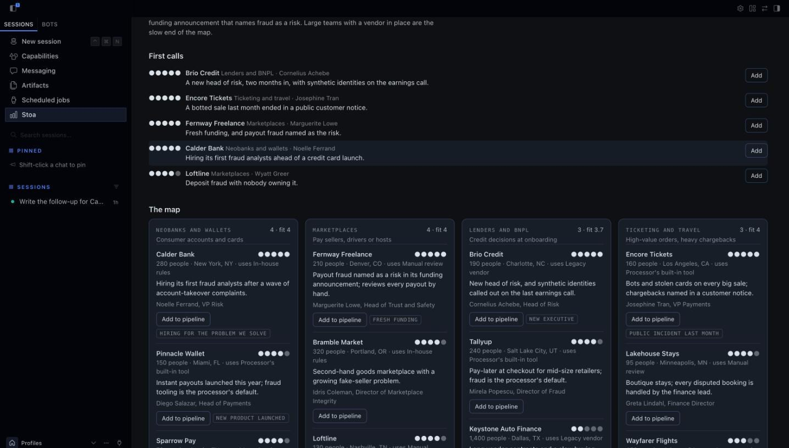

## What it looks like in chat

A card in Slack (shown here as the text version every other surface gets):

```
Dana Whitfield · Kestrel Labs
▰▰▰▱▱▱  Screened · 3 of 6
Search: Staff Backend · Northwind
Fee: $42k
Current title: Senior Backend Engineer
Comp expectation: $210k base
Next: Send submission note to Northwind (due 2026-11-10)

[ Submit to client ]  [ Draft follow-up ]  [ Enrich ]  [ Passed… ▾ ]  [ ⋯ ]
```

Press **Submit to client** and three things happen, in this order:

1. The record moves to *Submitted* and the activity log records who clicked. Instant, in SQLite.
2. The card redraws itself, in every channel it was posted to.
3. Hermes gets a turn in the card's thread with the playbook's instruction for that stage
   (*"Draft the submission note to the client: three bullet points on fit, comp and
   availability, and one honest risk"*) and replies with the draft.

Two people clicking the same button at once move the stage once, not twice: the check and the
change are one database transaction, so it holds across Slack, the web tab and the agent.
