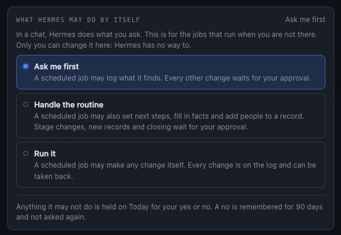
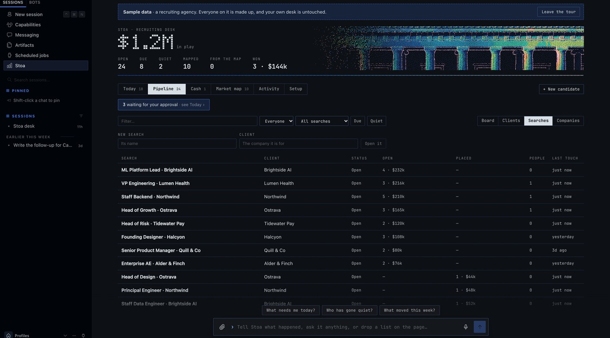

# What is in the plugin

Every part of Stoa, and its settings. For how a day on the desk goes, see [the guide](guide.md).

## What you get

| | |
|---|---|
| **12 tools** | `gtm_market`, `gtm_pipeline`, `gtm_deal`, `gtm_group`, `gtm_contact`, `gtm_invoice`, `gtm_card`, `gtm_intake`, `gtm_enrich`, `gtm_notes`, `gtm_playbook`, `gtm_export` |
| **Searches, accounts, clients** | The group a record is in is a thing of its own: who the client is, where it stands, its terms, and the people on the client's side |
| **Cash** | Invoices on a record in whole cents, what is owed and overdue, won work that was never billed, a delivery lane after the win, and a forecast weighted by stage |
| **Approvals** | What Hermes suggests waits for your yes or no, one decision each, with its evidence, or several of a kind in one press; a no is remembered; one you have already carried out closes itself; a scheduled job changes only what you allow |
| **Undo and a ledger** | Every change is kept with what it replaced, never altered; an action can be taken back unless that would overwrite a later change |
| **People and companies** | Several people on a record, each kept once across records, mail matched to the right record by whoever sent it, and one view per company |
| **Intake** | Send a list in any form; review what is new and what would change; apply what you tick |
| **Market maps** | Segments, fit scores, evidence and sources, with an **Add to pipeline** button per company |
| **Slack cards** | Advance, Draft follow-up, Enrich, close with a reason, snooze, reopen |
| **Desktop app and Webapp** | A live pane beside the chat, a Stoa page (Today, pipeline, searches or accounts, companies, cash, market map, activity, setup), and cards and maps drawn inside the conversation |
| **Web dashboard tab** | Live funnel, pipeline board, market map, activity feed, record side panels with actions |
| **`/gtm`** | The board, today, cash, the brief, a map or one record, on every surface Hermes runs on (CLI, Telegram, Desktop…). In Slack, `!gtm`, where a record or a map arrives with its buttons |
| **`hermes stoa`** | Status, board, brief, map, the ledger (`history`), autonomy, sample data, CSV import and export from a terminal |
| **7 automations** | Morning brief, email-call-and-Slack activity sweep, meeting-notes sweep, weekly market watch, Friday review, mirror to a Google Sheet, bring Sheet edits back, under `/blueprint` |
| **3 skills** | `stoa:desk` (how the agent runs the desk), `stoa:market-map`, `stoa:playbook-authoring` |
| **5 playbooks** | `b2b-sales`, `recruiting`, `agency`, `client-leads` (lead searches run for clients), `partnerships`, plus any you or the agent write |

### Market maps

*"We sell a fraud prevention tool to fintechs and marketplaces. Who should we go after?"*

Hermes names the market, splits it into segments that would each get a different pitch, and
agrees a short list of requirements with you: the things a fit company shows. Then it researches
companies for each segment, with its own web search or with [Exa](https://exa.ai) if you add a
key, and checks every one against those requirements. Each company goes on the map with:

- a fit score from 1 to 5, read off the requirements unless Hermes has reason to set it;
- the evidence for each requirement it shows, and the ones it does not;
- a buying signal, what it uses today, and the likely buyers;
- the source link.

```
Market map · Fintechs and marketplaces exposed to payment fraud
14 companies · 1 in the pipeline · 5 with a signal

Lenders and BNPL (3)
  ●●●●● Brio Credit · 190 people · Charlotte, NC  [in pipeline]
        New head of risk, and synthetic identities called out on the last earnings call.
  ●●●●○ Tallyup · 240 people · Salt Lake City, UT
        Pay-later at checkout for mid-size retailers; fraud is the processor's default.

Ticketing and travel (3)
  ●●●●● Encore Tickets · 160 people · Los Angeles, CA
        Bots and stolen cards on every big sale; chargebacks named in a customer notice.
```

The map then reads itself back. This is the part a list of names never gives you:

| | |
|---|---|
| **How rare each requirement is** | The share of checked companies that show each one. A scarce requirement is either too strict or the first question on every call. |
| **Who holds this market today** | What the companies use now. If most review by hand, you are selling against doing it by hand, not a competitor. |
| **Where the segments meet** | Companies that could sit in two segments: the second pool when one runs thin. |
| **Where they are, how big they are** | By region and headcount band. |
| **First calls** | The few to approach first and why, chosen by Hermes or, failing that, the strongest fits spread across segments. |
| **Reading the map** | Hermes's short interpretation and what to do about it, saved with the map. |

A map does not have to be of customers. In the recruiting example it is a talent map: the
companies where the candidates for one search work now, each with the people worth approaching.

In Slack each company has an **Add to pipeline** button. A tap creates the record at the first
stage of your playbook with the first known buyer as the contact, carries the evidence into its
activity log, and asks Hermes to confirm the buyer (or find one) and draft a first-touch note.
The *Market watch* automation re-checks a map every week and adds at most five new companies.

**A page to send.** `gtm_market(action="export")`, or **Download page** in the web tab, writes the
whole map as one self-contained web page: no scripts, no outside requests, nothing to host. The
share version leaves out buyers' names and what is in your pipeline.

### Intake

*"Here's the attendee list from the conference."* (with a PDF attached)

Hermes reads the file and hands Stoa the rows. Stoa then works out, with no model involved, what
each row would do:

| | |
|---|---|
| **New** | Nobody like this on the desk. It would be added at the first stage, or the stage the file gives. |
| **Update** | Already on the desk, and the file knows something the record does not, or says something different. Every change is listed: `stage Contacted → Screened`, `LinkedIn added`. |
| **Already there** | On the desk with nothing new. Left alone. |
| **Unclear** | Could be more than one record. Stoa asks which. |

A person is matched by email first, then LinkedIn, then name and company. The same person in a
different account or search is a new record, not an update. Nothing is written until you press
**Apply** in the app or in Slack, or say "apply all but 3". Two people pressing Apply write the
list once. A CSV on disk is read by the desk itself, in Excel's encoding too.

### The pipeline

Everything lives in one SQLite file under `<hermes home>/plugin-data/stoa/desk.db`: records,
the people on them, their activity log, which cards were posted where, and the enrichment cache.
It is per profile, it survives plugin updates, and you can open it with any SQLite tool.

- **A ledger of every change.** Beside the log a person reads, the file keeps a ledger: one line
  per change to a record or a person, with who made it, what it replaced and what it left. The
  database itself refuses to alter or remove a line, so it is the account of what happened, and
  it is what Undo reads. `hermes stoa history [record]` prints it.
- **Money in whole cents.** Amounts are stored as integers and added up as integers, so a
  pipeline total is exact. (The old decimal column is still written beside it, so an older
  version of the plugin can read the same file.)
- **Nothing a person does destroys a record.** Taking back an add takes the record off the
  desk and keeps it; *"bring Ada back"* (`gtm_deal(action="restore")`) returns it with its log.

Talk to it in plain language. *"Add Dana from Kestrel to the Northwind search." "I spoke to
Marcus, he wants 210 base, follow up Thursday." "We lost Lumen on price."* The agent writes each
of those to the desk in the same turn; the bundled skill teaches it to treat the desk, not its
memory, as the source of truth.

Every record carries one next step and a date. *"What needs me today?"* (or `/gtm today`) answers
with the same list the Today tab shows. *"Done, I sent the references"* logs the step and sets
the next one. *"Park Kestrel until the 20th"* snoozes it: a snoozed record is on neither the due
list nor the quiet list, in the page, the morning brief or Slack, until its date.

### Approvals, autonomy and undo

In a chat you are there, so Hermes does what you ask. The rest is for when you are not.

- **A scheduled job cannot outrun you.** The desk has one setting, changed only on the Setup tab
  or with `hermes stoa autonomy <ask|routine|full>`: no tool can change it, so the agent cannot
  raise it. **Ask me first** (the default): a job may log what it finds, and every other change
  waits for you. **Handle the routine**: it may also set next steps, fill in facts and add people
  to a record. **Run it**: it may make any change. This is enforced in the plugin, not in the
  prompt: a change the setting does not allow is not made, it becomes a proposal.



- **A proposal carries its case.** The record, what would change, one line of why, and up to four
  pieces of evidence: an email, a call, a message, with who and when and their words. You approve
  or decline each on Today (or apply a whole list at once). Approving is a person's: a scheduled
  job cannot apply or discard what is waiting.
- **A no is remembered.** A declined proposal is kept for 90 days and the same one is left out
  if it comes again. It is the same one only while the record has not moved: once the stage or
  the value it would replace changes, it counts as new. **Forget them** on Setup clears the memory.
- **Everything can be taken back.** One action (a click, a tool call, an approved proposal) is
  undone as one: *"undo that"*, the Undo offer on the page, or `gtm_deal(action="undo")`. It takes
  back the last action on a record, then the one before. An undo never overwrites a later change:
  if something the action set has been changed again since, nothing is taken back and you are told
  what stands in the way (*"Deal size is now $60k; that action left it at $50k"*). An earlier
  action whose values are untouched still goes back, whatever was logged after it. Undoing an add
  takes the record off the desk, and it can be put back.

### Cash: invoices, delivery and the forecast

*"I invoiced Kestrel 12k today, net 30." "Kestrel paid half of 1042." "How is cash looking?"
"What is likely to close this month?"*

- **Invoices** live on a record (`gtm_invoice`): add one (the amount defaults to whatever of the
  record's value is not billed yet, the due date to thirty days out), record a payment in part or
  in full, void it, correct it. Amounts are whole cents; an invoice is *overdue* when it is past
  its date and not paid in full, and *part paid* in between. Every change is on the ledger and
  can be taken back. Stoa sends nothing and moves no money.
- **Today** lists invoices that have gone overdue (with **Paid**, and **Draft a reminder** for
  Hermes to write), and, once you keep invoices on the desk at all, recent wins nobody has billed.
- **After the win**, a record sits in a delivery lane that your playbook names (`delivery:` in the
  YAML: Kickoff → In delivery → Delivered, say). Drag it along, or tell Hermes.
- **The forecast** weights each open record by how likely its stage is to close and puts it in
  the month of its expected close date (`close_on`, the **Expected close** field): past its date,
  this month, next month, later, no date. The odds come from this desk's own history once twelve
  records have closed; before that, from `win_probability` on each stage of the playbook; failing
  that, an even climb.
- **Hermes proposes, here too.** A sweep that sees a remittance email proposes the payment, with
  the email as evidence, for you to approve. A scheduled job never records money by itself
  unless you have set autonomy to *Run it*.

`/gtm cash` (or `gtm_pipeline(view="cash")`) gives the same picture in any chat.

### People and companies

*"Add their CFO, Lena Ortiz, to the Kestrel deal." "Who do we know at Kestrel?" "What do we have
going with Northwind?"* A record keeps its own person and any number of others. A person is kept
once and linked to each record they are on: add someone by an email the desk already knows and
they are linked, not entered twice; their title and email are theirs everywhere, and their role
is their part in one record. `gtm_contact(action="match")` tells the agent whose an email address
is: the record it belongs to, through anyone on it, or, for a stranger, the company their domain
belongs to and that company's open records, so a sweep files mail in the right place and can
propose adding the sender. A company is not something you set up: it is every record that names
it, however the name is written ("Kestrel Labs, Inc." and "kestrel labs" are one), plus the notes
and the email domain you keep on it.

### Searches, accounts and clients

A record names the group it is in: a search, an account, a client, a program, in your playbook's
word. The group is a thing of its own, kept under that name however it is typed:

- **The client.** The company it is for, and so the company that pays. In recruiting that is not
  the candidate's own company; a record in the search shows it, and so does an invoice.
- **Where it stands.** Open, on hold, done or closed.
- **Its terms.** What one record in it is worth (a new record takes that unless it brings its own),
  and the facts your playbook names for a group: for a search, fee type, fee %, target base,
  hourly rate, hours, contract end, location, guarantee. A playbook lists its own under
  `group_fields:`.
- **The people on the client's side.** A hiring manager or a sponsor belongs to the search, not to
  one candidate. Put there, their mail is recognised as being about that search, and "who do we
  deal with at Northwind?" finds them.
- **Notes**, and every change on the ledger.

**One client's list by itself.** *"Export the Northwind search"* writes a CSV of that search and
nothing else (`gtm_export(action="export", group=...)`, or **Export as CSV** on its panel). A
client's name in place of a search's gives everything that is for them.

**From a market map.** A playbook says where a company added from a map goes (`map_group`): into
the group named after the map, when a group is something you run and fill (a search, a lead list
for a client), or into a group of its own, when each company is an account. The `client-leads`
playbook is the first kind: name a map after the search, and its companies land in that search.

*"We are starting a Staff Backend search for Northwind at 20%"* opens one. On the page, the
Pipeline tab lists them beside the board and the companies; press one for its records, its
people and its terms. `gtm_group` is the tool; `gtm_contact(group=...)` keeps the people.



### Playbooks

A playbook is a short YAML file:

```yaml
name: recruiting
terms: {deal: candidate, deals: candidates, group: search, groups: searches, value: Fee}
stages:
  - {id: screened, label: Screened, stale_days: 3, advance: Submit to client}
  - {id: submitted, label: Submitted, stale_days: 4, advance: Client interview}
won:  {id: placed, label: Placed}
lost: {id: passed, label: Passed, reasons: [Not a fit, Comp mismatch, Client passed]}
drafts:
  on_enter:
    submitted: >
      Draft the submission note to the client for {name}: three bullet points on fit, comp and
      availability, and one honest risk. Quote only what is in the notes.
```

`stale_days` decides when a record counts as gone quiet at that stage. `advance` is the label on
the button. `drafts.on_enter` is what Hermes writes when a record arrives at a stage. An optional
`door` is the short name the first-launch chooser shows for it. Two more optional keys feed the
Cash tab: `win_probability` (0 to 100) on a stage, and a top-level `delivery:` list of what
happens after a win.

To make your own, tell Hermes how you sell: *"We install commercial solar. Set the desk up for
us."* It asks a few questions, shows you the stages, and saves the playbook. Or copy one from
[`playbooks/`](playbooks/) into `<hermes home>/plugin-data/stoa/playbooks/` and edit it.

### Meeting notes

Point `notes_dir` at any folder of Markdown or text call notes (an Obsidian folder, the export
folder of an open-source meeting recorder, files you drop in by hand), or add a Granola API key.
`gtm_notes` lists the notes that have not been filed and which record each one is probably
about. The agent reads a note, files a short summary on the right record with the next step,
and recommends a stage change for you to confirm. The *File meeting notes* automation does this
a few times a day.

### Enrichment

With a [People Data Labs](https://www.peopledatalabs.com/) key, the **Enrich** button and
`gtm_enrich` look up a person or company and fill the record's blank fields. It never overwrites
what a person typed, results are cached for 90 days, and a monthly cap (default 50 lookups)
keeps the bill predictable. A playbook with `enrich: none` removes the button and refuses the
lookup, for teams that do not want it at all.

### Gmail

Stoa writes drafts and never sends. When the Google Workspace skill (or any Gmail tool) is
connected to Hermes, the agent saves what it drafts as a Gmail draft addressed to the record's
email, ready for you to read and send. Without it, drafts arrive in the chat.

### Email, calls and Slack, logged for you

Switch on the *Log email, call and Slack activity* automation and, a few times a day, the agent
looks through whatever you have connected to Hermes (Gmail, a calendar or call recorder, Slack)
for anything that happened with the people on the desk.

- **It logs what it finds** on the right record, as a one or two sentence summary. Each email,
  message or call is logged once, however often the sweep runs.
- **It asks before moving anything.** When an email says the interview is booked or the contract
  is signed, the stage change and the new next step arrive as a review with a tick box per
  record, in Slack or in the app. Nothing moves until you apply it.
- **It proposes newcomers the same way.** Someone who writes in and is not on the desk yet is a
  row in that review, not a record.

Stoa has no mail or chat code of its own and holds no Google or Slack credentials for this: the
agent reads with its own tools, so it sees exactly what your Hermes can already see.

### Google Sheets

Connect Google to Hermes (its Google Workspace skill covers Gmail, Drive, Sheets and Docs) and
the desk can live in a Sheet as well:

- *"Mirror the desk to my Google Sheet."* Hermes writes the whole pipeline to a tab called
  `Stoa`: one row per record, in your playbook's own column names. The *Mirror the desk to a
  Google Sheet* automation keeps doing it a few times a day.
- *"Pull my Sheet edits."* Hermes reads the tab back and Stoa shows what people changed there
  (a stage, a fee, a new row) as a review to approve, the same card as any other list. The
  *Bring Sheet edits back* automation does that once a day.

The records themselves stay in Stoa's own database, which is what keeps a button click instant.
The Sheet is as fresh as its last mirror, and a Sheet edit reaches the desk when you approve it,
not the moment it is typed.

### Spreadsheets

`gtm_export` writes the whole pipeline to a CSV that opens in Google Sheets or Excel, and reads
one back in (with a dry run first). That is how you move in from a spreadsheet, and how you get
a copy out for a board meeting. Import reads the files spreadsheets actually produce: Excel's
encoding, a stray comma in a row, due dates written as `12/01/2026` or `Dec 1`. A row it cannot
use is reported with its row number and the rest still come in.

Due dates are stored as dates. Say "tomorrow", "Friday" or "+3d" and the desk works it out; say
something it cannot read and it tells you, and nothing is saved.

## Settings

All optional. Set them in the Desktop app under **Settings → Plugins → Stoa**, or in
`config.yaml` under `plugins.entries.stoa.settings`.

| Setting | Default | What it does |
|---|---|---|
| `playbook` | `b2b-sales` | Which playbook the desk runs on |
| `channels` | empty | Chat ids where the desk is available; empty means everywhere. Add `cron` to let scheduled jobs use it too. Button clicks are refused outside these chats as well |
| `slack_users` | empty | Slack user ids (they start with `U`) who may press the buttons on any card, review or map. Empty means only the person a card was posted for can press its buttons |
| `import_dir` | empty | A folder the agent may read CSV files from by path, besides the plugin's own `imports/` folder and the working directory |
| `notes_dir` | empty | Folder of call notes to watch |
| `notes_days` | `7` | How far back the notes inbox looks |
| `pdl_monthly_cap` | `50` | Most paid lookups per calendar month (0 = no cap) |
| `PDL_API_KEY` (secret) | empty | Turns on enrichment and buyer lookup |
| `EXA_API_KEY` (secret) | empty | Lets the market map search for companies directly |
| `GRANOLA_API_KEY` (secret) | empty | Adds Granola notes to the inbox |

One permission is worth granting. For a button click to start the agent's writing turn, Hermes
needs to let the plugin queue a message:

```yaml
plugins:
  entries:
    stoa:
      allow_gateway_injection: true
```

Without it everything else still works: the stage moves, the card updates, and the card's thread
gets a line saying *"Saved. Reply here and I'll write it up."*

Hermes lets a plugin continue a conversation a person started, never open one. So a card you
asked the agent for hands its drafts straight back to that conversation. A card that arrived
another way (from `!gtm`, or a scheduled job) waits for your reply in its thread; the task is
picked up the moment you answer.

A click is answered at once and a writing task is never lost. The card says **Drafting…** under
its buttons the moment you press one, and pressing the same button again while that draft is
being written changes nothing. The task is saved on the record before the hand-off and cleared
when the agent opens the record to do it. If no draft turn has started within 45 seconds, the
card changes to **Draft waiting** and the thread is told how to ask.
